# Biblia de Dirección Artística y Pipeline Agéntico Antislop — Astra Dream

> **Propósito:** Documento rector de dirección artística, contratos visuales y arquitectura del pipeline de producción de assets (IA Generativa + Procesamiento Agéntico en Python + Shaders en Godot 4.7 `mobile`).
> **Filosofía Central:** *"Usar la limitación como lente unificadora"*. Así como los artistas de Sega Genesis y Super Nintendo usaban el dithering y el sangrado de fósforo del televisor CRT para transformar paletas de 16 colores en transparencias y brillos imposibles, **Astra Dream** transforma imágenes estáticas generadas o descargadas mediante una receta matemática determinista que destruye toda huella de "AI slop" y funde el juego en una estética de autor.

---

## 1. Diagnóstico de Limitaciones Técnicas y Operativas

### 1.1 Limitaciones y Fortalezas del Motor (Godot 4.7.2 — Renderizador `mobile`)
- **Configuración Base (`project.godot`):** Resolución `1920x1080`, `stretch/mode="canvas_items"`, `aspect="expand"`, `renderer/rendering_method="mobile"`, color de limpieza base `#06060E`.
- **Restricciones en 3D:** Sin iluminación global pesada (SDFGI/VoxelGI) y presupuesto acotado de luces dinámicas y sombras en el Hangar (`hub_world.gd`). Los materiales PBR metálicos lisos sobre primitivas básicas (`CylinderMesh`, `TorusMesh`) delatan "geometría de motor por defecto".
- **Fortalezas en 2D y Shaders:** Excelente desempeño en `CanvasItem` shaders de una sola pasada, mezcla aditiva (`BLEND_MODE_ADD`), `MultiMeshInstance2D` (`BulletServer` con hasta 5.000 proyectiles zero-allocation) y fondos procedurales por capas (`CosmosRootNode`).

### 1.2 Limitaciones de la Generación con IA (Gemini / Imágenes Estáticas / Recursos Web)
| Debilidad Crítica ("Delator de IA / Slop") | Cómo Nuestra Filosofía la Convierte en Ventaja |
|---|---|
| **Inconsistencia temporal frame a frame:** La IA no puede generar hojas de sprites animadas sin que tiemblen las líneas o muten las proporciones. | **Cero Spritesheets de IA:** El movimiento a 60 FPS proviene de shaders de inclinación 2.5D, despiece modular rígido de 3 a 5 partes en jefes (estilo *Treasure 16-bit*) e *Impact Frames / Cut-Ins* estilo anime. |
| **Degradados plásticos y negros lavados:** Cada generación trae un gris oscuro distinto (`#1E222A`, `#251F2D`) y sombreados de aerógrafo artificial. | **Umbralización a Tinta Abisal (`#080812`) + Cuantización Cel-Shade:** Un script Python aplasta automáticamente las sombras al mismo negro canónico y convierte los medios tonos en escalones duros con trama **Halftone**. |
| **Micro-detalles derretidos ("ruido mecánico sin sentido"):** De cerca, las chapas o armaduras generadas por IA muestran trazos incoherentes. | **Filtrado Kuwahara + 70% Chiaroscuro Mignola en Naves:** El suavizado pictórico previo a la posterización borra el micro-ruido y el interior en sombra negra sólida esconde cualquier artefacto interno. |
| **Bordes sucios y grosores de línea dispares:** Al quitar el fondo quedan halos grises/blancos y cada imagen tiene un trazo diferente. | **Erosión Alfa + Entintado Morfológico Uniforme:** El pipeline recorta, erosiona 1-2px de halo y estampa un contorno de tinta exacto (o doble borde tipo sticker en íconos) idéntico en todo el juego. |

---

## 2. El Paradigma Visual: "Celuloide Entintado vs. Luz Óptica de Fósforo (OVA 90s)"

La identidad visual de **Astra Dream** se basa en el contraste físico que tenían los OVAs de ciencia ficción de los años 90 (*Macross Plus*, *Gunbuster*, *Cowboy Bebop*) combinados con el entintado dramático de *Mike Mignola* y el diseño gráfico de *Studio Trigger / Persona 5 / Hi-Fi Rush*:

1. **LA MATERIA (Naves, Jefes, Estaciones, Pilotos, Hangar, UI):**
   - Representada como **celuloide entintado a mano e impreso**: bordes de tinta negra firme, sombras negras profundas (`#080812`), bloques de color plano (cel-shading duro) y transiciones en **trama de puntos (halftone)**.
2. **LA ENERGÍA (Explosiones, Láseres, Propulsores, Balas Danmaku, Hologramas):**
   - Representada como **luz óptica pura de tubo CRT (`BLEND_MODE_ADD` + Bloom suave)**: nubes de plasma radiales incandescentes, estelas luminosas suaves y núcleos blancos brillantes que flotan sobre la tinta negra de las naves y el espacio abisal.

---

## 3. Regla de Asimetría Funcional por Tipo de Entidad

Para maximizar tanto el carisma de las heroínas (Visual Novel / Gacha / Hangar) como la legibilidad táctica del combate danmaku, aplicamos una proporción asimétrica entre **Cel-Shade Trigger (Opción 1)** y **Chiaroscuro de Tinta Negra Mignola (Opción 3)**:

### 3.1 Personajes / Pilotos (`fullbody_*.png`, `portrait_*.png`, Dialogic & Gacha)
- **Proporción:** **70% Studio Trigger Cel-Shade / 30% Tinta Negra Mignola.**
- **Tratamiento Visual:**
  - Piel, rostro y cabello mantienen colores vivos y expresivos en **3 escalones tonales duros** (Luz, Base, Sombra).
  - Las sombras profundas de pliegues de ropa, cabello interior y accesorios caen a **Negro Tinta Puro (`#080812`)** con bordes cortantes.
  - **Trama Halftone** sutil únicamente en la frontera entre el tono base y la sombra del traje/cabello.
  - Acentos emisivos de alta energía en visores, núcleos del traje y armas personales (controlados por `*_skin_mask.jpg` y shader emisivo).

### 3.2 Naves, Enemigos, Jefes y Estaciones Orbitales (`scenes/combat/`)
- **Proporción:** **30% Studio Trigger Cel-Shade / 70% Tinta Negra Mignola + Acentos Neón.**
- **Tratamiento Visual:**
  - El **60% a 70% del volumen interno** del casco de las naves y jefes se colapsa a **Negro Tinta Abisal (`#080812`)** y **Acero Noche (`#141829`)**.
  - La silueta y las placas principales se definen mediante **líneas de tinta negra gruesas + luz de borde (rim-light) y venas de energía neón**.
  - **Beneficio Directo en Gameplay:** Al ser los cuerpos de los jefes y enemigos mayoritariamente oscuros con bordes definidos, las balas brillantes del `BulletServer` y los láseres del jugador jamás se confunden cuando pasan por encima de una nave gigante.

---

## 4. Paleta Cromática Semántica y Jerarquía de Luminancia

El color en **Astra Dream** no es decorativo: obedece una **codificación semántica estricta** para que el jugador lea la pantalla en milisegundos.

| Rol Semántico | Nombre del Tono | Hex Canónico | Luminancia Relativa | Uso Exclusivo en el Juego |
|---|---|---|---|---|
| **0. Base de Tinta / Vacío** | *Abyssal Ink* | `#080812` | 3% – 5% | Sombras Mignola de naves/pilotos, lado oscuro de planetas, fondo de paneles UI y vacío espacial profundo. |
| **1. Casco / Metal en Sombra** | *Night Hull* | `#161B30` | 10% – 18% | Tono medio de blindajes mecánicos, estructuras del Hangar 3D y escombros espaciales. |
| **2. Entorno Cósmico (`CosmosRootNode`)** | *Deep Nebula Violet / Teal* | `#1A103C` / `#0D2B3E` | **Máx. 35%** *(Techo estricto)* | Nebulosas FBM y galaxias de fondo. Prohibido superar 35% de luminancia fuera del núcleo solar. |
| **3. Jugador y Arsenal Aliado** | *Electric Cyan / Starlight* | `#00F0FF` / `#6E7BFF` | 65% – 85% | Nave del jugador, propulsores aliados, láseres y proyectiles propios (con alpha/grosor controlado para no tapar amenazas). |
| **4. Amenaza Letal / Danmaku (`BulletServer`)** | *Acid Magenta / Solar Orange* | `#FF0055` / `#FF5E00` + `#FFFFFF` | **95% – 100%** | Proyectiles enemigos (núcleo blanco puro `#FFFFFF` + halo cálido/ácido), lásers de jefes y puntos débiles. |
| **5. Economía / Satélites / Buffs** | *Quantum Amber / Holo Mint* | `#FFD000` / `#00FF9D` | 80% – 90% | `SatelliteShop`, `SlotMachineBeacon`, `TransmutationStation`, cofres, llaves cuánticas y cápsulas de curación. |

---

## 5. VFX, Explosiones y Regla de Visibilidad Danmaku

Siguiendo la elección **Opción 3 (Arcade Clásico con Plasma Aditivo y Bloom Suave)**:

1. **Estética de Energía ("90s OVA Optical Glow"):**
   - Explosiones de enemigos, impactos balísticos y estelas de motores usan partículas y sprites radiales con mezcla aditiva (`CanvasItemMaterial.BLEND_MODE_ADD`), gradientes suaves de plasma incandescente y resplandor de fósforo CRT.
2. **Blindaje de Legibilidad para `BulletServer` (Anti-Encandilamiento):**
   - **Orden de Renderizado (`z_index`):** Toda nube de explosión, plasma aditivo, estela y disparo del jugador se dibuja estrictamente **por debajo** de la capa del `BulletServer`.
   - **Techo de Saturación en Explosiones:** Las nubes de plasma aditivo tienen un `alpha` máximo de `0.75` y decaimiento rápido de núcleo blanco ($< 0.12\,\text{s}$) hacia tonos saturados medios para evitar quemar la pantalla a blanco cuando mueren 20 enemigos juntos.
   - **Anillo de Contraste en Proyectiles Enemigos:** El shader/textura de cada proyectil en `BulletServer` incluye:
     1. **Núcleo interior:** Blanco puro (`#FFFFFF`) de alta lectura.
     2. **Cuerpo cromático:** Halo luminoso en Magenta Ácido (`#FF0055`) o Naranja Solar (`#FF5E00`).
     3. **Borde exterior de corte (Contrast Rim):** Un anillo perimetral fino de baja luminancia / alta saturación oscura (`#2A0018`) que garantiza que la bala recorte su silueta incluso si pasa exactamente por encima de una explosión blanca o la corona de un sol.

---

## 6. Animación a 60 FPS sin Spritesheets de IA ("Híbrido Treasure 16-bit + Anime Cut-In")

Prohibido generar secuencias de frames animados mediante IA. Todo el movimiento se produce en motor a partir de assets estáticos limpios:

1. **Naves de Jugador y Enemigos Comunes (Sprite Estático Único + Shader 2.5D):**
   - Cada nave es **1 único PNG estático** procesado por el pipeline.
   - **Inclinación 2.5D (Banking):** Al desplazarse lateralmente o girar, el shader `ink_cel_ship_2d.gdshader` comprime ligeramente el eje transversal y desplaza la máscara de luz de borde (rim-light), simulando alabeo tridimensional suave.
   - **Propulsión Procedural:** Las llamas de los motores y ondas de energía son 100% nodos de partículas/shaders en Godot anclados a `Marker2D`.
2. **Jefes y Estaciones Orbitales (Rigging Rígido Multi-Parte estilo *Gunstar Heroes / Gradius*):**
   - Cada jefe o estación se diseña y recorta en **3 a 5 piezas rígidas independientes** (`CoreHull`, `LeftWingPod`, `RightWingPod`, `TurretMount`, `HoloRing`).
   - La animación se ejecuta por código/Tweens en Godot: retroceso elástico (recoil) al disparar ráfagas danmaku, rotación continua de anillos, apertura mecánica de compuertas antes de un patrón letal y desprendimiento físico con explosiones de plasma al destruir fases.
3. **Pilotos en Combate, Hangar y Diálogos:**
   - **En Hangar 3D y Dialogic:** Respiración orgánica suave por deformación UV de baja frecuencia en torso/cabello + barrido de brillo holográfico en visor y ojos (`skin_glow_spatial.gdshader`).
   - **En Combate (Bombas, Críticos, Alertas de Rival/Boss):** **Anime Cut-Ins** diagonales que cruzan la pantalla con líneas de velocidad (speedlines) + **2 frames de Impact Frame** (inversión de alto contraste blanco y negro puro al detonar una bomba o romper la fase de un jefe).

---

## 7. Integración por Dominio del Juego

### 7.1 Entorno Cósmico (`CosmosRootNode` y `.tres` en `scenes/combat/environment/cosmos/resources/data/`)
- **Espacio Abisal Anime 90s:**
  - Los biomas de nebulosa (`biomes/*.tres`) mantienen zonas amplias de vacío en `#05050B` para que el espacio respire y las naves entintadas se integren con el cosmos.
  - Los planetas (`default_shadow_system.tres` y shaders planetarios) proyectan el hemisferio eclipsado en **Negro Tinta (`#080812`)** con una transición de penumbra estilizada en trama halftone y un fino borde atmosférico luminoso hacia la estrella.
  - Los escombros de `ParallaxDebrisBelt` usan siluetas rocosas/metálicas entintadas oscuras (`#141829` + sombra `#080812`) para no confundirse con proyectiles ni pickups.

### 7.2 Hangar 3D (`hub_world.gd` y `PedestalVisualPresenter`)
- **Diorama Teatral 2.5D ("Ink & Halftone Spatial"):**
  - Reemplazo de los materiales `StandardMaterial3D` PBR lisos en pedestales, pisos y columnas por un shader espacial unificado (`hub_ink_cel_spatial.gdshader`) que corta la sombra 3D de las luces a negro tinta (`#080812`) con banda intermedia en trama halftone y aristas marcadas en cian/magenta.
  - Los haces holográficos (`HoloBeam`), anillos (`RimNeon`, `RotatorRing`) y luces (`PedestalLight`) conservan su naturaleza de **energía aditiva suave con bloom**, replicando en 3D el mismo contraste *Materia Entintada vs. Energía de Fósforo* del combate 2D.
  - La escenografía de fondo del hangar (arcos estructurales, grúas, cables, pasarelas) se viste con **bastidores 2D entintados colocados a distintas profundidades Z en el espacio 3D**, logrando parallax real de diorama sin costo de geometría 3D compleja.

### 7.3 UI, Modales e Iconografía (`GameHUD`, `LevelUpModal`, `ShopModal`, `ArcanaModal`, `RunForkOverlay`, `GachaModal`)
- **Viñetas de Manga / Cómic Dinámico (*Persona 5 / Hi-Fi Rush*):**
  - Los contenedores de modales y tarjetas reemplazan los rectángulos redondeados convencionales por **polígonos asimétricos inclinados** con doble borde recortado (Blanco Puro `#FFFFFF` + Negro Tinta `#080812`), fondos de tinta con gradiente de puntos halftone en las esquinas y cabeceras en tipografía condensada inclinada de alto impacto.
  - El `HudDragonRadarDisplay` mantiene su lugar como instrumento táctico retro-futurista de cabina integrado en un marco entintado.
- **Íconos como Stickers Pop-Manga Recortados (Stencils de 3 Tonos):**
  - Todo ícono de arma (`WeaponData`), ítem pasivo (`ItemData`) o arcana se procesa como un **emblema gráfico de silueta audaz en 3 tonos** (Sombra Tinta `#080812` + Color Semántico Base + Luz con Halftone).
  - Alrededor de la silueta lleva un **borde negro grueso (4px) seguido de un contorno exterior blanco anguloso tipo sticker recortado (4-5px)**. Esto garantiza lectura instantánea tanto a `32x32px` en el dock del HUD como a tamaño grande en las tarjetas de elección.

---

## 8. Especificación Técnica del Pipeline Híbrido ("La Máquina Antislop")

El flujo de trabajo para incorporar cualquier imagen (generada con Gemini/`image-generator` o descargada) se divide en **Horneado Agéntico Offline (Python)** y **Shaders de Tiempo Real (Godot)**.

```mermaid
flowchart LR
    A["Imagen Cruda (IA / Web)<br/>Fondo sólido blanco o magenta"] --> B["Script Python: tools/art_pipeline/stylize_asset.py"]
    subgraph Offline ["Fase 1: Horneado Agéntico Offline (Python)"]
        B --> C["1. Extracción Alfa + Erosión 2px<br/>(Elimina halos sucios)"]
        C --> D["2. Filtro Kuwahara / Bilateral<br/>(Borra micro-ruido plástico IA)"]
        D --> E["3. Cuantización por Perfil<br/>pilot (70/30) | ship (30/70) | sticker"]
        E --> F["4. Entintado Morfológico<br/>Outline #080812 (+ Borde Sticker Blanco)"]
        F --> G["5. Extracción de Máscara Emisiva<br/>*_glow_mask.png"]
    end
    G --> H["Assets Listos en res://assets/<br/>(PNG Base + PNG Máscara)"]
    H --> I["Fase 2: Shaders Ligeros en Godot 4.7 Mobile<br/>(Halftone en pantalla, Inclinación 2.5D, Bloom Aditivo)"]
```

### 8.1 Fase 1: Script Agéntico Offline (`tools/art_pipeline/stylize_asset.py`)
El script recibirá el archivo de entrada y el perfil (`--profile pilot | ship | boss_part | sticker_icon | hangar_prop`) y ejecutará determinísticamente:

1. **Segmentación Limpia y Erosión de Halo:**
   - Remoción del color de fondo sólido con umbral de tolerancia y **erosión morfológica del canal alfa de `2px`** para amputar cualquier píxel semitransparente contaminado por el fondo original.
2. **Purga de Textura de IA (Filtro Kuwahara / Bilateral):**
   - Aplicación de un pase de preservación de bordes y aplanamiento de regiones internas que destruye el granulado sintético de difusión y deja pinceladas planas tipo animación en celuloide.
3. **Mapeo de Luminancia y Aplastamiento a Tinta (`#080812`):**
   - En perfil `ship` / `boss_part`: Todo píxel con luminancia $L < 0.45$ (y baja saturación) se fuerza matemáticamente al **Negro Tinta Canónico `#080812`**. Los tonos entre $0.45 \le L < 0.75$ se cuantizan a 2 escalones de color de casco (`#161B30` y color de facción).
   - En perfil `pilot`: Las sombras por debajo de $L < 0.25$ se fuerzan a `#080812`, preservando 3 escalones limpios en piel, cabello y vestimenta.
   - En perfil `sticker_icon`: Posterización agresiva a 3 tonos planos de máximo contraste.
4. **Estampado Morfológico de Contorno:**
   - Dilatación de la máscara alfa para estampar un **borde de tinta exterior e interior uniforme en `#080812`** de grosor parametrizado (`3px` en naves/pilotos).
   - En perfil `sticker_icon`, aplica una segunda dilatación poligonal/angulosa exterior en **Blanco Puro (`#FFFFFF`)** de `5px` para crear el efecto de sticker recortado estilo *Persona 5 / Hi-Fi Rush*.
5. **Generación Automática de `*_glow_mask.png`:**
   - Los píxeles con alta saturación/luminancia en los canales semánticos (cian, magenta, naranja, ámbar, menta) se exportan automáticamente a una textura compañera de máscara emisiva para que los shaders de Godot iluminen únicamente visores, núcleos y venas de energía.

### 8.2 Fase 2: Shaders Ligeros en Tiempo Real (Godot 4.7 `mobile`)
Para mantener **60 FPS constantes** en iGPU / Steam Deck / Desktop:
1. **`shaders/ink_cel_entity_2d.gdshader` (Naves, Jefes, Satélites):**
   - Aplica la **trama Halftone** en espacio de pantalla o UV sobre la banda de transición entre el tono medio y el negro `#080812`.
   - Lee `*_glow_mask.png` para pulsar la energía neón con `TIME`.
   - Incluye el parámetro `bank_tilt: float` (`-1.0` a `1.0`) para la deformación de inclinación 2.5D al girar y `hit_flash: float` para el destello de impacto en blanco/negro puro.
2. **`shaders/hub_ink_cel_spatial.gdshader` (Hangar 3D Diorama):**
   - Reemplaza el sombreado Lambert/PBR suave por un corte `step()` hacia `#080812` con franja de puntos halftone y borde Fresnel en el color de la piloto activa.
3. **`shaders/manga_panel_ui.gdshader` (Modales y Cartas UI):**
   - Dibuja marcos sesgados con doble contorno blanco/negro, trama halftone diagonal animada en el fondo y destellos de barrido al seleccionar una carta.

---

## 9. Reglas de Prompting para Generación Agéntica de Nuevos Assets

Siempre que un agente o desarrollador invoque la generación de imágenes para **Astra Dream**, el prompt base debe cumplir estas directrices para maximizar la calidad del horneado posterior:

1. **Fondo Obligatorio:** Solicitar siempre **fondo plano sólido de un único color de contraste** (gris neutro `#808080` o blanco puro `#FFFFFF` para assets con bordes negros) sin viñeteado ni sombras proyectadas en el suelo, facilitando el recorte exacto.
2. **Palabras Clave de Estilo (`Style Lock`):**
   - **Para Pilotos:** `"90s retro sci-fi anime cel-shaded character illustration, Studio Trigger and Mike Mignola heavy black ink shadows, flat posterized color blocks, crisp bold black ink linework, zero soft airbrush gradients, isolated on flat solid background"`.
   - **Para Naves / Piezas de Jefes:** `"Top-down 2D arcade spaceship sprite, 70% pitch-black heavy ink shadow core (#080812) in Mike Mignola style, sharp cel-shaded armor plates, glowing neon energy veins, crisp outer silhouette, isolated on flat solid background"`.
   - **Para Íconos de Armas / Ítems:** `"Bold graphic pop-manga emblem icon, Persona 5 and Hi-Fi Rush style stencil, 3 flat high-contrast colors, heavy black ink shadow, clean recognizable silhouette at small scale, isolated on flat solid background"`.

---

## 10. Pipeline Validado de Pilotos 2D Modulares (`PilotRigLab v6` — Sandbox I+D)

El flujo oficial para producir nuevas pilotos animadas a 60 FPS desde arte IA y experimentar su identidad visual antes de promoverlas a producción reside íntegramente en [`sandbox/pilot_rig_lab/`](../sandbox/pilot_rig_lab/) (guía completa y prompts listos para copiar en [`PILOT_CREATION_GUIDE.md`](../sandbox/pilot_rig_lab/PILOT_CREATION_GUIDE.md)):

1. **Arquitectura de 4 Etapas (Cero Spritesheets IA):**
   - **Paso 1 (`9:16` Master Concept):** Ilustración vertical completa sobre chroma verde (`#4EB347`) para máxima resolución en rostro/piernas.
   - **Paso 2 (`16:9` Hoja 3-Zonas):** Extracción de **6 piezas modulares aisladas** (`head`, `torso`, `hips_legs`, `arm_right_bent`, `arm_left_straight`, `cape`).
   - **Paso 3 (`16:9` Clown Pass Semántico):** Mapa plano sin sombras de 6 colores puros sobre blanco (`#FFFF00` piel desnuda, `#00FF00` medias translúcidas, `#00FFFF` pelo, `#FF0000` acentos/visor, `#0044FF` armadura metálica, `#FF00FF` tela/capa) que resuelve de raíz el problema de colisión de luminancia en cel-shading.
   - **Paso 4 (`build_pilot_rig_pipeline.py --pilot <id>`):** Recorte de componente conexa principal + **Upscayl 4x GPU (`digital-art-4x`)** + **Euclidean Distance Transform (EDT)** con fijación de borde a `#080812` (`0` píxeles verdes residuales) + registro IoU de `<part>_id_mask.png`.
2. **Estudio Interactivo en Tiempo Real (`pilot_rig_lab.tscn` + `pilot_rig_stylizer.gdshader`):**
   - **Cinematografía 2D FK Autónoma:** Pivote en pies plantados (`hips_legs` con weight-shift shader), jerarquía FK de torso (`head`, brazos y capa siguen rotación/escala desde la cintura) y física elástica UV en busto/capa sin widgets invasivos.
   - **Experimentación de Identidad y Recoloreo:** 9 perfiles base + guardado/restauración en `saved_style_profiles.json`, 5 algoritmos matemáticos de recolor (`Multiplicativo`, `Gradiente 3-Tonos`, `Remapeo HSL`, `Overlay/Hard-Light`, `Cel-Ramp 3-Bandas`), 6 patrones de trama (`CMYK`, `Líneas Manga`, `Cruzada`, `Micro-Punto`, `Hexágonos`, `Scanlines`), Lab independiente de cabello (`Bicolor`, `Dip-Dye`, `Angel Ring`), comparador **A/B lado a lado**, preview **Escala In-Game + Balas Danmaku**, **Inspector Rayos-X**, **Calco Fantasma 9:16** y soporte multi-piloto (`pilots/<id>/`).
