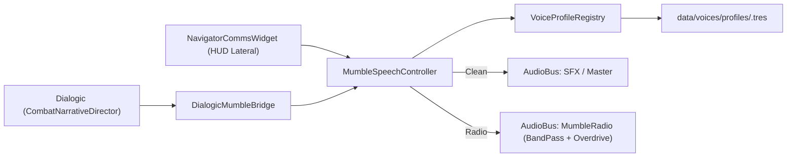

# Sistema Híbrido de Mumble Speech (Voces de Diálogo)

> **Propósito:** Proveer voces estilizadas por personaje (pilotos, mascotas, navegantes y jefes) de forma **100% data-driven**, tanto con síntesis procedural de formantes como con micro-samples reales (`.wav`/`.ogg`), integradas en `MainGame` (Dialogic + `NavigatorCommsWidget`) y en `DialogueWorkbench`.

---

## 1. Arquitectura y Flujo de Señales

### Archivos Clave
- **Modelo de datos:** [`data/voices/voice_profile_data.gd`](../data/voices/voice_profile_data.gd) (`VoiceProfileData`)
- **Registro y caché:** [`data/voices/voice_profile_registry.gd`](../data/voices/voice_profile_registry.gd) (`VoiceProfileRegistry`)
- **Motor de audio:** [`core/audio/mumble_speech_controller.gd`](../core/audio/mumble_speech_controller.gd) (`MumbleSpeechController`)
- **Puente Dialogic:** [`core/audio/dialogic_mumble_bridge.gd`](../core/audio/dialogic_mumble_bridge.gd) (`DialogicMumbleBridge`)
- **Integración combate:** [`scenes/combat/directors/combat_narrative_director.gd`](../scenes/combat/directors/combat_narrative_director.gd) y [`scenes/ui/hud/navigator_comms_widget.gd`](../scenes/ui/hud/navigator_comms_widget.gd)
- **Calibrador visual:** [`sandbox/mumble_speech_lab/mumble_speech_lab.tscn`](../sandbox/mumble_speech_lab/mumble_speech_lab.tscn)
- **Banco de diálogos:** [`sandbox/workbenches/dialogue_workbench/dialogue_workbench.tscn`](../sandbox/workbenches/dialogue_workbench/dialogue_workbench.tscn)

---

## 2. Catálogo de Perfiles `.tres` (Placeholders Actuales)

Todos los archivos residen bajo `res://data/voices/profiles/` y se resuelven automáticamente por el ID del hablante en Dialogic (`.dch`) o `navigator_id`.

| Categoría | ID / Archivo | `base_pitch` | `formant_hz` | `syllable_duration_sec` | `radio_filter_enabled` | Notas Placeholder |
|---|---|---|---|---|---|---|
| **Fallback** | `default.tres` | `1.00` | `410` | `0.065` | `false` | Voz neutra por defecto |
| **Piloto** | `valentina.tres` | `1.08` | `460` | `0.065` | `false` | Media-clara, firme |
| **Piloto** | `nova.tres` | `1.00` | `400` | `0.065` | `false` | Equilibrada, comandante |
| **Piloto** | `kira.tres` | `1.14` | `510` | `0.060` | `false` | Ágil, enérgica (`min_interval_ms=45`) |
| **Piloto** | `selene.tres` | `0.94` | `365` | `0.068` | `false` | Serena, analítica |
| **Piloto** | `roxy.tres` | `0.90` | `330` | `0.062` | `false` | Grave y mordaz (`exclamation_vol_db=2.5`) |
| **Piloto** | `echo.tres` | `1.04` | `435` | `0.075` | `false` | Suave, resonante |
| **Piloto** | `nyx.tres` | `0.84` | `300` | `0.072` | `false` | Grave y contenida |
| **Mascota** | `mochi.tres` | `1.48` | `740` | `0.055` | `false` | Aguda y alegre |
| **Mascota** | `kuro.tres` | `1.22` | `560` | `0.058` | `false` | Juguetona media-aguda |
| **Mascota** | `luna.tres` | `1.38` | `680` | `0.060` | `false` | Suave y aguda |
| **Mascota** | `pip.tres` | `1.58` | `820` | `0.048` | `false` | Muy rápida y chillona (`min_interval_ms=38`) |
| **Mascota** | `cosmo.tres` | `1.30` | `620` | `0.058` | `false` | Brillante intermedia |
| **Navegante** | `lyra.tres` | `1.06` | `450` | `0.064` | `true` | Radio táctica clara |
| **Navegante** | `caelia.tres` | `0.96` | `385` | `0.068` | `true` | Radio táctica templada |
| **Navegante** | `iris.tres` | `1.15` | `520` | `0.060` | `true` | Radio táctica ágil |
| **Navegante** | `vespera.tres` | `0.88` | `325` | `0.072` | `true` | Radio táctica grave |
| **Navegante** | `zephyr.tres` | `1.10` | `480` | `0.062` | `true` | Radio táctica viva |
| **Jefe / Esp.** | `sombra_nyx.tres` | `0.72` | `240` | `0.082` | `true` | Distorsión grave y lenta |

---

## 3. Guía de Fine-Tuning (Parámetros de `VoiceProfileData`)

Cada propiedad del `.tres` se puede editar desde el Inspector de Godot o en tiempo real desde `MumbleSpeechLab`:

- **`base_pitch` (`0.5` – `2.2`):** Multiplicador de tono global (`pitch_scale` del `AudioStreamPlayer`).
  - *Voz grave/autoritaria:* `0.75 – 0.95`
  - *Voz humana estándar:* `0.95 – 1.15`
  - *Mascota/IA aguda:* `1.25 – 1.65`
- **`pitch_variance` (`0.0` – `0.35`):** Variación aleatoria por sílaba. Valores bajos (`0.04–0.06`) suenan más robóticos/serios; valores altos (`0.11–0.16`) suenan más expresivos o juguetones.
- **`formant_hz` (`160` – `1200` Hz):** Frecuencia base del sintetizador procedural de 5 vocales. Controla el **timbre/cuerpo** de la voz (a diferencia de `base_pitch`, cambiar `formant_hz` altera el carácter sin acelerar tanto la envolvente).
- **`syllable_duration_sec` (`0.03` – `0.14` s):** Duración de cada sílaba sintetizada. Sílabas cortas (`0.045–0.060`) funcionan mejor para habla rápida; sílabas más largas (`0.075–0.090`) dan pausa o solemnidad.
- **`chars_per_blip` (`1` – `5`):** Cada cuántos caracteres visibles (ignorando espacios y signos) se dispara un sonido. `2` o `3` suele ser el punto óptimo para evitar efecto metralleta.
- **`min_interval_ms` (`20` – `150` ms):** Anti-phasing temporal mínimo entre dos blips aunque el jugador acelere el texto. Recomendado: `45–60 ms`.
- **`question_pitch_boost` (`0.0` – `0.45`):** Elevación progresiva de `pitch_scale` en el último 35% de frases terminadas en `?`.
- **`exclamation_vol_db` (`0.0` – `6.0` dB):** Refuerzo de volumen (y ligero pico tonal) cuando la frase termina en `!`.
- **`volume_db` / `volume_jitter_db`:** Nivel base y fluctuación orgánica de volumen por sílaba.
- **`radio_filter_enabled` (`bool`):** Enruta la voz al bus dinámico `MumbleRadio` (BandPass `1450 Hz` + Overdrive `0.18`). En transmisiones de cockpit/boss en `CombatNarrativeDirector` y en `NavigatorCommsWidget`, el filtro radio se fuerza automáticamente.

---

## 4. Cómo Migrar de Synth Procedural a Micro-Samples Reales

El sistema es **híbrido** sin cambiar una sola línea de código:

1. Prepara entre **3 y 6 clips cortos** (`.wav` o `.ogg`, `40–80 ms` cada uno, recortados al inicio sin silencio muerto y normalizados a `-6 dB` / `-3 dB`).
2. Abre el `.tres` del personaje en el Inspector de Godot (por ejemplo `res://data/voices/profiles/valentina.tres`).
3. Arrastra esos clips al array **`samples`** (`Array[AudioStream]`).
4. En cuanto `samples` no está vacío, `MumbleSpeechController` deja de usar los formantes procedurales para ese personaje y reproduce tus clips reales aplicando `base_pitch`, `pitch_variance`, entonación `?`/`!`, cadencia y filtro radio automáticamente.

> **Tip:** Puedes compartir un mismo pack de 4–5 micro-sílabas neutras entre varios pilotos y diferenciarlos cambiando `base_pitch`, `chars_per_blip` y `min_interval_ms` en sus `.tres`.

---

## 5. Flujo de Calibración en Sandbox y Pruebas

1. **Ajuste fino interactivo:**
   - Abre [`sandbox/mumble_speech_lab/mumble_speech_lab.tscn`](../sandbox/mumble_speech_lab/mumble_speech_lab.tscn) y pulsa **F6**.
   - Selecciona el `.tres` en el desplegable, prueba frases con `?`, `!` o texto libre, mueve los sliders en vivo y pulsa **💾 Guardar .tres**.
2. **Prueba en contexto real de diálogos:**
   - Abre [`sandbox/workbenches/dialogue_workbench/dialogue_workbench.tscn`](../sandbox/workbenches/dialogue_workbench/dialogue_workbench.tscn) y pulsa **F6**.
   - En la sección **Mumble Speech (Voces .tres)** puedes pulsar **Voz Piloto / Voz Pet / Voz Nav** para audiciones rápidas, **Recargar .tres** tras editar archivos externos, o lanzar cualquiera de los escenarios reales (`Prólogo Táctico`, `Cara a Cara Rival`, `Radio Navegante`, etc.).

---

## 6. Cómo Añadir la Voz de un Nuevo Personaje

1. Duplica un `.tres` existente en `res://data/voices/profiles/` con el nombre exacto en minúsculas del personaje (ej. `lyra.tres`, `valentina.tres`, `<nuevo_id>.tres`).
2. Actualiza `profile_id` y `display_name` dentro del `.tres` y ajusta su timbre.
3. No requiere registro en código: `VoiceProfileRegistry` lo descubrirá automáticamente al coincidir con el nombre del `.dch` de Dialogic o el `navigator_id`.
