# Playbook Integral Multi-Piloto v2 — De Scaffold a Combate In-Game

> **Propósito:** Guía operativa definitiva para construir el resto del cast (**Nova, Kira, Selene, Roxy, Echo, Nyx**) replicando el estándar consolidado de **Valentina v2** hasta producción (`CharacterSelectUI`, `HubRigAvatar3D`, `CosmeticsManager`, `Dialogic` y `MainGame`).
> **Índice de scripts Python:** [`sandbox/pilot_rig_lab/tools/README.md`](../sandbox/pilot_rig_lab/tools/README.md) · **Reglas del dominio:** [`.agents/rules/pilot_rig_lab.md`](../.agents/rules/pilot_rig_lab.md).

---

## Mapa Rápido del Flujo (Etapas 0–9)

```mermaid
flowchart LR
    E0["0. Scaffold (.tres + dirs)"] --> E1["1. Arte Base 8-Dir (5 cuerpos + 8 cabezas)"]
    E1 --> E2["2. Máscaras IA + Rig Pack"]
    E2 --> E3["3. Ink SDF 2x"]
    E3 --> E4["4. Rig Facial + Ojos Live2D"]
    E4 --> E5["5. Alas 3D/2D + VFX"]
    E5 --> E6["6. Arma & Anillo Orbital"]
    E6 --> E7["7. Live Banner + Icono + Dialogic"]
    E7 --> E8["8. Calibración en Labs (WorkbenchHub)"]
    E8 --> E9["9. Activación en CharacterData + Tests"]
```



### Entornos Python
- **CV / Scipy / Upscayl / Scaffold (`build_*`, `ink_hq_pipeline.py`, `scaffold_new_pilot.py`):** `python` (`C:\Python313\python.exe` en este equipo)
- **Segmentación ML (`prepare_8dir_sheets.py`, `prepare_ai_mask_workspaces.py`):** `sandbox/pilot_rig_lab/tools/.venv/Scripts/python.exe`

---

## Etapa 0 — Scaffold del Nuevo Piloto (Cero copia manual)
Ejecutar el generador usando `data/pilots/valentina_v2/` como plantilla base:
```powershell
python sandbox/pilot_rig_lab/tools/scaffold_new_pilot.py `
  --pilot-id nova_v2 `
  --display-name "Nova v2 (8-Dir)" `
  --char-id nova `
  --accent-hex "#FF661A"
```
Esto crea automáticamente:
- `data/pilots/<pilot_id>/` con los `17` `.tres` raíz (`<pilot_id>_profile.tres`, `base_pose`, `idle_anim`, `locomotion_anim`, `kiting_anim`, `turn_anim`, `jiggle_physics`, `face_anim`, `base_propulsion`, `wings_3d`, `propulsion_vfx`, `orbital_weapon`, `live_banner`, `combat_rig`, `skin_catalog`, `anim_config`, `perspective_config`) + `skins/00_base..09_*.tres`.
- `assets/pilots/<pilot_id>/{planar,banner}` y `sandbox/pilot_rig_lab/source_refs/<pilot_id>/00_raw/` (protegido con `.gdignore`).

---

## Etapa 1 — Arte Base 8-Dir (5 Cuerpos + 8 Cabezas 4×2)
Para evitar deriva angular al pedir 8 cuerpos completos desde cero:
1. **Plantillas de referencia:** `build_head_and_body_gen_kit.py` genera tiras limpias para IA (`S, SE, E, NE, N` en Zero-G A-Pose sobre `#808080`, más grilla `4×2` para 8 cabezas closeup). Ver prompts en [`docs/art/character_25d_generation_guide.md`](art/character_25d_generation_guide.md) y [`GOOGLE_AI_PROMPTS.md`](../sandbox/pilot_rig_lab/reference_templates/GOOGLE_AI_PROMPTS.md).
2. **Mateado y normalización:**
   - `prepare_8dir_sheets.py` → Upscayl 4× + mateado `#808080`/IS-Net + canvas `1560×1680` + reconstrucción simétrica `SW/W/NW` por espejado e intercambio `L/R`.
   - `process_sw_and_8dir_heads.py` → normaliza las 8 cabezas a `1024×1024` y empalma cabeza auténtica `SW` sobre el cuerpo `flip(SE)`.

---

## Etapa 2 — Máscaras IA, Overlays HD y Ensamblado del Rig
1. **Workspaces IA estándar:** `prepare_ai_mask_workspaces.py --export` crea `01_parts_5_despiece`, `02_id_mask_bodies`, `03_id_mask_heads`, `04_limb_anim_masks`, `05_secondary_jiggle_masks`; tras procesar con IA se ejecuta `--ingest all`.
2. **Regeneración HQ de máscaras por pieza (`ID`, `Normal/Depth`, `ILM`):** `export_piece_mask_sheets.py` + `ingest_piece_mask_sheets.py --kind id|normal|ilm` (ver `rig_v2_lib/piece_mask_prompts.py`).
3. **Invariante crítico de cabezas:** En `heads/head_*_id_mask.png`, el canal azul (`B = 255`) marca el cuello inferior para separar `head_layer_pass = 1` (bajo torso) vs `2` (sobre torso).
4. **Ensamblado del pack:** `python sandbox/pilot_rig_lab/tools/build_valentina_v2_rig_assets.py` (apuntando al directorio destino en `assets/pilots/<pilot_id>/planar/`) exporta `parts_5/`, `heads/`, `parts_5_meta.json`, `heads_metadata.json`, `body_metrics.json` y láminas de auditoría. *(Si hacen falta retoques locales de torsos/caps/hombreras, usar `ingest_hd_torsos_16x9.py`, `ingest_cap_sheets_16x9.py` y `ingest_pauldron_polish_16x9.py`).*

---

## Etapa 3 — Tinta Interna HQ `Ink SDF 2×`
- Ejecutar `ink_hq_pipeline.py --action export|test|apply --sheet <hoja>` sobre `07_ink_hq_regen/` (doble referencia `inputs_color/` + `inputs_anchor/` → Upscayl 4× → ECC Afín + Farneback → SDF `2×`).
- **Invariante:** Los mapas `*_ink_sdf.png` deben cargarse **sin mipmaps** (`use_mipmaps = false`) y mantener el relleno de traje oscuro/botas/guantes en `#FFFFFF` puro (solo trazos negros `#000000`).

---

## Etapa 4 — Rig Facial Vivo + Ojos Live2D
1. **Máscaras faciales (`rig_face_live.gdshaderinc`):** `export_head_live_mask_sheet.py` → `fuse_head_live_mask_sheet.py` → `ingest_head_live_rig_assets.py`.
2. **Ojos Live2D e injerto `4× SSAA`:** `export_eye_live2d_sheets.py` → `ingest_eye_live2d_assets.py` genera capas oculares animables (`head_front_eye_iris.png`, `head_front_eye_closed.png`, etc.) y respalda las cabezas nativas.
3. Verificar expresiones, parpadeo, soldadura cervical y cabello 3-zonas en **Face Lab** (`face_lab/valentina_face_lab.tscn`) guardando en `<pilot_id>_face_anim.tres`.

---

## Etapa 5 — Alas 3D Cel-Shaded / Alas 2D Base & VFX
- **Estándar Multi-Piloto (Alas 3D):** Consultar [`VALENTINA_3D_WINGS_CREATION_GUIDE.md`](VALENTINA_3D_WINGS_CREATION_GUIDE.md) y [`VALENTINA_3D_LAB_SPEC.md`](VALENTINA_3D_LAB_SPEC.md). Calibrar `<pilot_id>_wings_3d.tres` en **3D Lab** (`3d_lab/valentina_3d_lab.tscn`).
- **Alternativa 2D por cuchillas (`enable_base_propulsion_wings`):** Compilar 3 vistas `#808080` con `build_valentina_v2_wings.py --sheet <hoja> --out-dir assets/pilots/<pilot_id>/planar/wings --audit` (ver [`VALENTINA_BASE_PROPULSION_WINGS_SPEC.md`](VALENTINA_BASE_PROPULSION_WINGS_SPEC.md)).
- **Estela / Power-Up VFX:** Ajustar `<pilot_id>_propulsion_vfx.tres` y `<pilot_id>_base_propulsion.tres` en **VFX Lab** (`vfx_lab/valentina_vfx_lab.tscn`).

---

## Etapa 6 — Armamento Orbital 2.5D/3D
- **Arma característica:** Compilar sprite `#808080` con `build_valentina_weapon.py --src <png> --out-dir assets/pilots/<pilot_id>/planar/weapons --name <weapon_name>` o reutilizar/personalizar la malla 3D (`orbital_weapon_3d_renderer.gd`).
- **Anillo Orbital:** Generar textura RGBA empaquetada `1:1` con `build_orbital_ring_texture.py --src <png> --out-dir assets/pilots/<pilot_id>/planar/weapons --name <char_id>_mecha_ring` (actualiza `ring_texture_path` en `<pilot_id>_combat_rig.tres`).
- Calibrar `<pilot_id>_orbital_weapon.tres` en **Guns Lab** (`guns_lab/valentina_guns_lab.tscn`). Ver [`VALENTINA_ORBITAL_WEAPON_SPEC.md`](VALENTINA_ORBITAL_WEAPON_SPEC.md).

---

## Etapa 7 — Live Banner 2.5D, Icono `512×512` y Retratos de Diálogo
1. **Splash Art + 4 Máscaras (`parts`, `mat`, `depth`, `ink`):** Compilar con:
   ```powershell
   python sandbox/pilot_rig_lab/tools/build_valentina_live_banner.py `
     --src <splash.png> --mask-parts <m1.png> --mask-mat <m2.png> `
     --mask-depth <m3.png> --mask-ink <m4.png> `
     --out-dir assets/pilots/<pilot_id>/banner --prefix <pilot_id>
   ```
   Ver prompts y spec en [`VALENTINA_LIVE_BANNER_SPEC.md`](VALENTINA_LIVE_BANNER_SPEC.md) y [`VALENTINA_LIVE_BANNER_PROMPTS.md`](VALENTINA_LIVE_BANNER_PROMPTS.md).
2. **Icono `1:1` (`512×512`):** Refinar close-up facial tomando `<pilot_id>_icon_1x1.png` como referencia para `portrait_icon`/`avatar_icon` en `CharacterData`.
3. **Retratos de Diálogo (`.dch`):** Actualizar `narrative/characters/<char_id>.dch` con los retratos del personaje y validarlos en **Dialogue Workbench** (`sandbox/workbenches/dialogue_workbench/dialogue_workbench.tscn`).

---

## Etapa 8 — Calibración Integral en Labs & Catálogo de Skins
1. Abrir `sandbox/workbenches/workbench_hub.tscn` (`F6`), elegir el nuevo piloto en el selector superior **Piloto Activo (Cast v2)** y recorrer:
   - **Proto (`planar_combat_rig_proto.tscn`):** validar 8 vistas `s..sw`, escala `display_scale`, sin flip horizontal (`body_flip_x = false`).
   - **Anim Lab (`planar_anim_test.tscn`):** calibrar Pose Base, Idle, Locomoción, Kiting, Giros y Jiggle guardando directo en `data/pilots/<pilot_id>/*.tres`.
   - **Shader Lab (`planar_shader_lab.tscn`) & Cosmos Lighting Lab (`valentina_cosmos_lab.tscn`):** validar `02_valentina_razor_sharp.tres`, skins e iluminación cósmica.
   - **Banner Lab (`valentina_banner_lab.tscn`):** ajustar pivotes `chest_center_uv`, `right_shoulder_uv`, alas y Lock-In en `<pilot_id>_live_banner.tres`.
2. **Skins Shader:** Ajustar paletas en `data/pilots/<pilot_id>/skins/*.tres` y `<pilot_id>_skin_catalog.tres` (`pilot` / `wings` / `weapon`).

---

## Etapa 9 — Activación en Producción (`CharacterData`) y Verificación
1. Editar `data/characters/roster/<char_id>.tres`:
   - `pilot_rig_profile` → `res://data/pilots/<pilot_id>/<pilot_id>_profile.tres`
   - `live_banner_config` → `res://data/pilots/<pilot_id>/<pilot_id>_live_banner.tres`
   - `shader_skin_catalog` → `res://data/pilots/<pilot_id>/<pilot_id>_skin_catalog.tres`
   - `portrait_icon` / `avatar_icon` → `res://assets/pilots/<pilot_id>/banner/<pilot_id>_icon_1x1.png`
   - `is_playable_rework_ready = true`
2. Validar en **Character Select Workbench**, **Dialogue Workbench**, **Combat Gym** (1–4 armas + Overfocus + `OverheadHealthBar`), `HubWorld` y tests:
   ```powershell
   powershell -ExecutionPolicy Bypass -File tools/run_tests.ps1 -Test "workbenches_and_combat_gym"
   powershell -ExecutionPolicy Bypass -File tools/run_tests.ps1 -Test "test_player_valentina_v2_combat"
   powershell -ExecutionPolicy Bypass -File tools/run_tests.ps1 -Test "test_roster_rework_lockout"
   powershell -ExecutionPolicy Bypass -File tools/run_tests.ps1 -Test "pilot_rig_lab"
   powershell -ExecutionPolicy Bypass -File tools/run_tests.ps1 -CoreOnly
   ```
