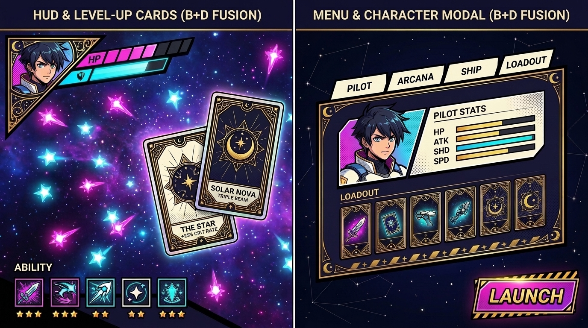

# Dirección Artística de UI — Rework Futuro (*Astral Pop-Ink*)

> **Estado:** Dirección estética **aprobada y registrada** para el futuro rework integral de interfaces.  
> **Nota de alcance:** Este documento fija la identidad visual elegida y sus pilares técnicos base. **Antes de implementar cambios en producción**, esta especificación deberá desarrollarse en mayor profundidad (tokens exactos de color, tipografías definitivas, spec de shaders, wireframes por pantalla y prototipo en `sandbox/workbenches/workbench_hub.tscn`).

---

## 1. Estilo Elegido: **Astral Pop-Ink** *(Fusión B + D)*

Combinación de dos lenguajes visuales complementarios:

1. **Pop-Arcade / Cel-Shaded Ink (Estilo B — *Persona 5 / Hi-Fi Rush*):**
   - Contornos gruesos de tinta negra que dialogan directamente con el **Ink SDF 2×** de Valentina v2.
   - Cortes diagonales dinámicos, energía arcade, alto contraste (bloques marfil/hueso vs. índigo/negro tinta), tramas *halftone* sutiles y cintas de acción de alto impacto (evolucionando `TapeMarqueeButton`).
2. **Celestial / Tarot Cósmico (Estilo D — *Hades / Granblue Fantasy*):**
   - Filigranas geométricas doradas, motivos de constelaciones/estrellas y marcos astrales.
   - Cartas de **Level-Up, Arcanas, Run Forks y Gacha** tratadas como cartas de Tarot cósmico con brillo *foil* holográfico por shader.

### Referencia Visual Aprobada

---

## 2. Diagnóstico que Motiva el Rework

- Ausencia de `Theme` global en `project.godot` y uso de una sola fuente (`assets/fonts/Play Pretend.otf`).
- Predominio de `StyleBoxFlat` oscuros con borde cian 1–2 px repetidos manualmente en escenas (`hud.tscn`, `character_select.tscn`, `game_over_layout_builder.gd`).
- Transiciones en seco (`show()`/`hide()`) en `BaseModal` sin *motion*, blur ni feedback táctil/sonoro unificado.

---

## 3. Pilares Técnicos Objetivo (Enfoque Híbrido — Godot 4)

Alineado con las reglas centrales del proyecto (**Data-Driven `.tres`**, **Modularidad** y aprovechamiento de `viewport/hdr_2d=true`):

1. **Design System Global (90% Procedural + Shaders):**
   - `Theme` maestro registrado globalmente en `project.godot`.
   - Recurso `.tres` de **Design Tokens** (paleta índigo profundo / tinta negra / marfil / dorado astral / acentos magenta y cian, radios, márgenes y tiempos de animación).
   - **Pairing tipográfico de 3 fuentes** (OFL/gratuitas): *Display* con carácter arcade/celestial, *Body* limpia para lectura y *Tabular/Mono* para telemetría (HP, DPS, timers, coordenadas).
   - Shaders reutilizables: paneles biselados con contorno de tinta SDF, trama *halftone*, *foil* holográfico para cartas Tarot y barras reactivas con rastro de daño retrasado (*ghost bar*).
2. **Piezas "Hero" Vectoriales / 9-Slice (10% Arte dedicado):**
   - Kit compacto y reutilizable de 4–5 adornos: esquineros dorados de constelación, divisor astral, marco de retrato del HUD y marco base de carta Tarot.
3. **Capa Sistémica de *UI Juice*:**
   - Mejora centralizada en `BaseModal` (backdrop blur + viñeta animada + entrada escalonada *stagger* de tarjetas).
   - Componente reutilizable de micro-interacciones (`UIButtonJuice`: *hover lift*, destello de borde, *press squash* y SFX vía `AudioManager`).

---

## 4. Próximos Pasos (Cuando se Active la Fase de Rework)

1. **Profundización de diseño:** cerrar paleta exacta, tipografías definitivas, reglas de legibilidad en combate danmaku y especificación por pantalla (HUD, Level-Up/Arcanas/Forks, Character Select, Hub/Modales, Title Screen y Dialogic).
2. **Vertical Slice en Sandbox:** prototipar y calibrar el nuevo sistema primero sobre `sandbox/workbenches/workbench_hub.tscn` (`hud_workbench`, `dialogue_workbench`, `character_select_workbench`).
3. **Rollout progresivo a producción:** aplicar el `Theme` maestro, `BaseModal` mejorado y escenas prioritarias con verificación mediante `tools/run_tests.ps1`.
