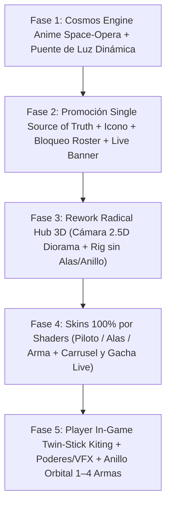
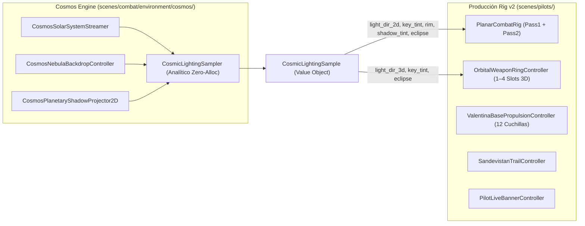

# Plan Maestro — Integración Integral de Valentina v2, Upgrade de Cosmos Engine, Hub 2.5D, Skins por Shader y Anillo Orbital de Armas

> **Estado actual:** **Fases 1–5 COMPLETADAS Y VERIFICADAS ✅** (Integración Total en Producción Cerrada: Cosmos Engine + Roster/Banner + Hub 3D 2.5D + Skins por Shader + Combate In-Game `PlayerRigV2Controller` & Anillo Orbital 1–4 Slots)
> **Documento de estado del rig:** [`VALENTINA_V2_MILESTONE_STATUS.md`](VALENTINA_V2_MILESTONE_STATUS.md)

## Objetivo General

Llevar **Valentina v2** desde `sandbox/pilot_rig_lab/` hasta producción como la nueva base arquitectónica y visual de **Astra Dream**, elevando primero **Cosmos Engine** al estándar **Anime Space-Opera estilizado** y conectando su iluminación dinámica al rig, para luego cerrar el ciclo completo de juego (**Character Select**, **Hub 3D**, **Skins por Shader** y **Combate In-Game** con **Anillo Orbital 2.5D multi-arma**).

La ejecución se divide en **5 Fases Secuenciales e Independientes** (con verificación visual y suite de tests en verde al cierre de cada fase, cumpliendo la higiene de sesiones atómicas).

---

## Decisiones Aprobadas

1. **Fuente Única de Verdad en Producción:** El runtime y assets compilados de Valentina v2 se mueven a `scenes/pilots/`, `data/pilots/` y `assets/pilots/`. Los laboratorios de `sandbox/pilot_rig_lab/` pasarán a consumir producción (dependencia estricta de una sola vía: **Producción nunca importa de `sandbox/`**).
2. **Bloqueo del Roster y Migración de Saves:** `CharacterData` incorporará `is_playable_rework_ready: bool`. Solo `valentina` iniciará activa (`true`). Los perfiles existentes con otra piloto seleccionada se migrarán automáticamente a `valentina` y las otras 6 heroínas quedarán grisadas/bloqueadas (*"En Rework"*) en UI y excluidas del Gacha, conservando intactos sus `.tres` y scripts para futuros reworks.
3. **Repropósito del Slot `ship` -> `wings` (Alas/Propulsión):** Para pilotos v2, `pilot` controla el exo-traje unificado (Banner, Hub y Combate), el antiguo slot `ship` se convierte en **Alas / Propulsión** (`ValentinaBasePropulsionController`), y `weapon` controla el **Rail-Lance 3D**. Cero PNGs pre-horneados de recolor.
4. **Limpieza de Assets Legacy de Valentina:** Se eliminan los PNGs legacy exclusivos de Valentina (`fullbody_valentina*`, `ship_valentina*`, `weapon_valentina*`, `recolors/*valentina*`) al cerrarse la Fase 2/4 (historial respaldado en Git).
5. **Nuevo Icono Close-Up Estilizado:** Generar con `image-generator` usando `valentina_v2_icon_1x1.png` como referencia estricta para lograr un close-up facial con mayor personalidad.
6. **Hub 3D Diorama 2.5D:** Cámara fija en ángulo `~42°` y `FOV 38°` sin giro de 180°, retirando/abriendo el techo oclusor y utilizando `PlanarCombatRig` en `SubViewport` HDR sin alas ni anillo en levitación Zero-G.
7. **Combate In-Game Twin-Stick Kiting 360° & Anillo Multi-Arma:** `Player` orienta el rig 8-Dir hacia el cursor/objetivo fijado (strafe + reversa), dispara `SandevistanTrailController` + Alas Overdrive + Monóculo HUD / Ojo Amatista durante todo el bullet-time del Repliegue Táctico, y soporta 1–4 armas independientes en el Anillo Orbital 2.5D naciendo desde sus bocas 3D proyectadas (usando paletas por `WeaponData` sobre la malla 3D actual como placeholders iniciales).

---

## Arquitectura Transversal de Iluminación y Promoción

---

## Fase 1 — Upgrade Visual de Cosmos Engine (Anime Space-Opera) + Puente de Iluminación al Rig

### Objetivo
1. Elevar la calidad gráfica y coherencia estética de Cosmos Engine al lenguaje **Anime Space-Opera estilizado** (*Trigger / Honkai: Star Rail / Guilty Gear*): nebulosas pictóricas con bandas suaves de contraste profundo, planetas con terminador semi-cel y rim atmosférico vibrante, estrellas con corona estilizada y destellos anamórficos, y escombros con silueta limpia — preservando oscuridad controlada para legibilidad danmaku y respetando `SettingsManager.space_background_quality` (`0/1/2`).
2. Implementar el puente analítico de iluminación (`Cosmos Engine` -> `Rig Valentina v2` + `Anillo 3D`): **Sol + Bioma + Eclipse planetario**, con piso mínimo de legibilidad en combate.

### Cambios Clave
- **Shaders Cosmos (`scenes/combat/environment/cosmos/shaders/`):** `universe_nebula.gdshader`, `celestial_body.gdshader`, `star_corona.gdshader`, `star_light_field.gdshader`, `debris_cutout.gdshader`.
- **Balance Data-Driven (`.tres`):** calibración de los 6 biomas (`biome_01..06`), `default_cosmic_biome.tres`, `default_star_visual.tres`, `default_shadow_system.tres`, `default_cosmos_environment.tres`.
- **Puente Analítico Zero-Alloc:** `CosmicLightingSample`, `CosmicRigLightingConfig` (`default_rig_lighting.tres`), `CosmicLightingSampler` y `CosmosHostController.sample_lighting_at(...)`.
- **Consumo en Rig y Armas 3D:** `apply_cosmic_lighting(...)` en `PlanarRigMaterialController`, `PlanarCombatRig`, `ValentinaBasePropulsionController`, `OrbitalWeapon3DRenderer`, `OrbitalWeaponRingController` y `rail_lance_toon_3d.gdshader`.
- **Calibración y Tests:** `sandbox/pilot_rig_lab/cosmos_lighting_lab/valentina_cosmos_lab.tscn` + `tests/unit/test_cosmic_lighting_sampler.tscn`.

### Estado: ✅ COMPLETADA (Cosmos Engine v3.2c)
- **Entregables cerrados y verificados:**
  - 7 arquetipos estelares (`black_hole` con lente gravitacional y `emerald_nova`), rotación/relieve planetario multi-mapa, anillos y cometas tangentes a `-vel.normalized()`.
  - Órbitas keplerianas 3D inclinadas + overlay `[O]`/`[G]` (`CosmosOrbitGuidesOverlay2D`), 4 sectores no estelares en ~35% de parcelas (`Rogue World`, `Derelict Armada`, `Warp Relay`, `Ion Nursery` + teletransporte `[N]`), corredores interestelares (`hyperspace`, `bow-shocks`, meteoros, ríos laminares de asteroides) y landmarks lejanos en perspectiva 3D integrados detrás de `DustMidSprite` (`z_index = -25`).
  - Puente analítico zero-alloc (`CosmicLightingSampler`) conectado a `PlanarCombatRig` + `AstralWings` + `OrbitalWeapon3D`, auditado en Vulkan 1.4 y validado con `24/24 -CoreOnly PASS`.
  - **Siguiente paso (nueva sesión):** Iniciar **Fase 2** (*Single Source of Truth* bajo `scenes/pilots/`, `data/pilots/`, `assets/pilots/`, nuevo icono close-up, bloqueo de roster con `is_playable_rework_ready` y `Live Banner` en `CharacterSelectUI`).

---

## Fase 2 — Promoción *Single Source of Truth*, Nuevo Icono, Bloqueo del Roster y Live Banner

### Objetivo
1. Promover runtime, shaders, `.tres` y assets compilados de Valentina v2 a producción (`scenes/pilots/`, `data/pilots/`, `assets/pilots/`), dejando `sandbox/pilot_rig_lab/` consumiendo producción para labs y conservando `tools/`, `.venv/`, `source_refs/` y `backups/` aislados.
2. Generar mediante `image-generator` un close-up facial estilizado de Valentina tomando `valentina_v2_icon_1x1.png` como referencia estricta (`512×512`).
3. Incorporar `is_playable_rework_ready: bool` en `CharacterData`: solo `valentina` activa, migrando saves viejos a `&"valentina"`, bloqueando/grisando (*"En Rework"*) las otras 6 pilotos en `CharacterSelectUI` y excluyéndolas de Gacha.
4. Montar `PilotLiveBannerController` en `CharacterSelectUI` (`CharacterLiveBannerViewport`) con parallax, parpadeo, jiggle y secuencia Lock-In (12 cuchillas + 2 Impact Frames) al desplegar.
5. Eliminar los PNGs legacy exclusivos de Valentina.

### Estado: ✅ COMPLETADA
- **Entregables cerrados y verificados:**
  - **Single Source of Truth en Producción:** Movidos runtime, shaders, esquemas, `.tres` y assets compilados a `scenes/pilots/` (`rig/`, `shaders/`, `vfx/`, `weapons/`, `banner/`, `PlanarRigCalibrationHelpers`), `data/pilots/` (`schemas/`, `hair/`, `styles/`, `valentina_v2/`) y `assets/pilots/` (`shared/persp_masks/`, `valentina_v2/planar/`, `valentina_v2/banner/`), sin `.gdignore` y con cero referencias hacia `sandbox/pilot_rig_lab/`.
  - **Nuevo Icono Close-Up (`512×512`):** Generado y ajustado a `assets/pilots/valentina_v2/banner/valentina_v2_icon_1x1.png` y enlazado en `data/characters/roster/valentina.tres` y `narrative/characters/valentina.dch`.
  - **Bloqueo del Roster + Migración + Gacha:** `is_playable_rework_ready` en `CharacterData` (`valentina = true`, resto `false`), migración no destructiva en `ProfileRosterData`/`MetaProgressionState` hacia `&"valentina"`, bloqueo visual (*"EN REWORK"*) y funcional en `HeroPickerModal`, `CharacterRosterGridBuilder`, `CharacterSelectUI` y `CharacterSelectLaunchController`, y exclusión en `CosmeticsManager`, `GachaBannerEngine` y `GachaWardrobeController`.
  - **Live Banner 2.5D en UI:** `CharacterLiveBannerViewport` (`SubViewportContainer` HDR + MSAA 4× con auto-pausa) integrado en `CharacterPilotShowcase`, `CharacterSelectUI` (Lock-In en `orbital_terminal.pressed`) y `HeroPickerModal` (con espera `0.52s` en runtime y resolución inmediata en headless).
  - **Limpieza & Verificación:** Eliminados los 9 PNGs legacy de Fase 2 (`selection_valentina*`, `portrait_valentina*`, `avatar_valentina.png`); aprobadas todas las suites de lab, `cosmic_lighting_sampler`, `test_roster_rework_lockout`, `persistence`, `slot_machine_and_gacha` y `24/24 -CoreOnly PASS`.
  - **Siguiente paso (nueva sesión):** Iniciar **Fase 3** (Rework Radical del Hub 3D: `HubRigAvatar3D` + cámara fija 2.5D Diorama `~42°` / `FOV 38°` + apertura de techo/muros en `+Z`).

---

## Fase 3 — Rework Radical del Hub 3D (Cámara Fija 2.5D Diorama + Rig Valentina v2 sin Alas ni Anillo)

### Objetivo
1. Reemplazar el `Sprite3D` legacy del Hub por `HubRigAvatar3D` (`SubViewport` `512×512`, `transparent_bg`, `use_hdr_2d`, `MSAA_4X` con `PlanarCombatRig` sin alas ni anillo orbital, `enable_face_live = true`, estilo `02_valentina_razor_sharp`).
2. Configurar cámara fija **2.5D Diorama**: `FOV 38°`, pitch fijo `-42°` (offset `Vector3(0, 9.2, 10.2)`), sin giro orbital de 180°, mapeando `WASD` directamente a las 8 direcciones del rig en levitación Zero-G.
3. Retirar/abrir el techo sólido (`BoxMesh_ceiling`) y rebajar muros oclusores en `+Z` de `hub_world.tscn` manteniendo pisos, terminales, ventanales `SpaceParallax`, mascotas y trofeos.
4. Dejar pedestales del resto del roster bloqueados/apagados (*"EN REWORK"*).

### Estado: ✅ COMPLETADA
- **Entregables cerrados y verificados:**
  - **Configuración Data-Driven:** `HubDioramaConfig` (`scenes/ui/hub/resources/hub_diorama_config.gd`) y `data/hub/default_hub_diorama_config.tres` parametrizando cámara Diorama, encuadre de `SubViewport` HDR, iluminación y lockout visual de pedestales.
  - **Avatar Vivo `HubRigAvatar3D`:** `scenes/ui/hub/components/hub_rig_avatar_3d.gd` con `SubViewport` `512×512` (`transparent_bg`, `use_hdr_2d`, `MSAA_4X`), `PlanarCombatRig` de `valentina_v2` con `enable_face_live = true`, estilo `02_valentina_razor_sharp`, cero alas y cero anillo orbital, sobre `AvatarSprite3D` inclinado (`-22°`) con levitación Zero-G y sombra proyectada sincronizada.
  - **Cámara Fija 2.5D Diorama & Locomoción 8-Dir:** `HubCameraController3D` y `HubPlayerController3D` migrados a `FOV 38°`, pitch `-42°` y offset `(0, 9.2, 10.2)` sin giro orbital de 180°, mapeando `WASD` directo a las 8 direcciones nativas (`s..sw`).
  - **Apertura Arquitectónica del Hangar:** Retirado `BoxMesh_ceiling` / colisión de techo, re-parentados `template-floor-layer2/3`, `NorthWindowLowerHull` y `NorthWindowGateFrame`, y rebajados/ocultados oclusores en `+Z` (`BackWall_*`, `KenneyGate`, `SouthWallWindow`, `South_Corner_*`, muros altos) en `hub_world.tscn` y `hub_hangar_builder_3d.gd`.
  - **Lockout de Pedestales (*"EN REWORK"*):** `PedestalVisualPresenter`, `HubPilotShowcaseController` y `HubWorld` mantienen a Valentina activa por defecto (`Cutout_Valentina` oculto por avatar vivo) y bloquean los otros 6 pedestales con aro apagado, insignia `"EN REWORK"` e interactuables deshabilitados.
  - **Verificación:** `test_hub_25d_valentina_rig`, `test_roster_rework_lockout`, `pilot_rig_lab` y `24/24 -CoreOnly PASS`.
  - **Siguiente paso (nueva sesión):** Iniciar **Fase 4** (Sistema de Skins 100% por Shaders — Piloto, Alas/Propulsión y Arma + Carrusel y Gacha Live).

---

## Fase 4 — Sistema de Skins 100% por Shaders (Piloto, Alas/Propulsión y Arma)

### Estado: COMPLETADA Y VERIFICADA ✅
1. **Esquemas & Catálogo Unificado Data-Driven:** `ShaderSkinEntry` (`data/pilots/schemas/shader_skin_entry.gd`), `PilotShaderSkinCatalog` (`data/pilots/schemas/pilot_shader_skin_catalog.gd`) y `data/pilots/valentina_v2/valentina_v2_skin_catalog.tres` (`00_base.tres` + 27 entradas across `pilot`, `wings`, `weapon` para `01_crimson_nebula`..`09_edgerunner_lucy`), enlazado a `CharacterData` / `valentina.tres`.
2. **Paridad de Shaders y Runtime en Vivo:**
   - `pilot`: aplica al rig (`PlanarCombatRig`), `PilotLiveBannerController` y `HubRigAvatar3D` con escalado emisivo `1★–3★` y refresco en caliente al equipar/cambiar personaje/cerrar modales.
   - `wings` (repropósito de `ship`, default `"follow_pilot"`): controla las 12 cuchillas 3D (`AstralWings3DController`), alas 2D base (`ValentinaBasePropulsionController`) y backlight alar independiente del Live Banner (`pilot_live_banner.gdshader`).
   - `weapon` (default `"follow_pilot"`): controla `OrbitalWeaponRingController` y `OrbitalWeapon3DRenderer` (`SURFACE_ARMOR`, `SURFACE_CHASSIS`, `SURFACE_CRYSTAL`) + `star_level`.
3. **Persistencia, Limpieza y Migración No Destructiva:** `CosmeticsManager`, `SaveSkinsModule` y `ProfileStorage` sincronizan `wings:<id>` ↔ `ship:<id>` y `character_loadouts`, migran IDs legacy obsoletos sin destruir progreso de otras pilotos, y limpian las 21 entradas legacy de Valentina en JSON + 329 archivos PNG/PSD obsoletos.
4. **UI Live 100% por Shader (`SubViewport` + Swatches):** `ShaderSkinLivePreview` (con auto-pausa `UPDATE_DISABLED`), `ShaderSkinSwatch` (`shader_skin_swatch.gdshader`), `CharacterEquipmentCards` (*ALAS / PROPULSIÓN* y *ARMA ORBITAL*), `CosmeticCarouselModal` y `GachaModal` (*🪽 ALAS Y ARMAS*, revelación + Armario live). Validado con [`tests/unit/test_shader_skins_system.tscn`](../tests/unit/test_shader_skins_system.tscn).

---

## Fase 5 — Personaje Main In-Game, Poderes/VFX y Anillo Orbital Multi-Arma (1–4 Slots)

### Objetivo
1. Integrar `Player` <-> `PlanarCombatRig` mediante un componente desacoplado `PlayerRigV2Controller` (anti God-Object):
   - Orientación **Twin-Stick / Kiting 360°** hacia cursor/objetivo fijado.
   - Iluminación cósmica en tiempo real (`CosmosHostController.sample_lighting_at(...)` zero-allocation).
   - Calibración de escala junto a `HitboxCore` (`z_index = 25`) y `set_cinematic_duel_facing()`.
2. Conectar Poderes y VFX de Valentina v2:
   - **Repliegue Táctico / Sobre-Enfoque (`Dash` + `1.5s` bullet-time `0.55×`):** `SandevistanTrailController` activo en todo el bullet-time (usando `unscaled_delta`) + Alas Overdrive (`SERAPH_BLOOM`) + brillo de monóculo HUD/ojo Amatista + micro Impact Frame + pulso de aberración cromática en bordes.
   - **Bomba Táctica, Daño, Escudo y OSP:** `hit_flash`, `trigger_impact_frame()`, expresiones faciales, reacciones alares (`AEGIS_GUARD` / `SERAPH_BLOOM`) y conservación de `PlayerBombController` / `PlayerShieldController`.
3. Conectar **Anillo Orbital 2.5D** con **1–4 armas independientes**:
   - Añadir `orbital_armor_color`, `orbital_chassis_color`, `orbital_crystal_color` y `orbital_mesh_id` a `WeaponData` y los 18 `.tres` (14 en `data/weapons/roster/` + 4 en `data/weapons/shop/`).
   - Regla híbrida: Slot `0` aplica skin cosmética de arma/piloto (o paleta `WeaponData` si está en `"base"`); Slots `1..3` exhiben la paleta `WeaponData` de cada arma con boost emisivo `star_level`.
   - Puntería independiente por slot (`0` cursor/blanco principal, `1..3` blancos pasivos o cursor en disparo activo), naciendo cada proyectil desde `get_slot_muzzle_world_pos(slot_idx)` proyectado `3D -> 2D` con recoil y muzzle flash propios.

### Estado: ✅ COMPLETADA Y VERIFICADA
- **Entregables cerrados y verificados:**
  - **Configuración Data-Driven:** `PilotCombatRigConfig` (`data/pilots/schemas/pilot_combat_rig_config.gd`), `data/pilots/valentina_v2/valentina_v2_combat_rig.tres` (`combat_rig_scale = 0.90` compensado contra `Player.scale = 1.2`) enlazado en `PilotRigProfile` / `valentina_v2_profile.tres`.
  - **Paletas Orbitales en Armamento:** `orbital_armor_color`, `orbital_chassis_color`, `orbital_crystal_color` y `orbital_mesh_id` añadidos a `WeaponData` y los 18 `.tres` (`roster/` + `shop/`).
  - **Controlador Desacoplado `PlayerRigV2Controller`:** `scenes/combat/player/player_rig_v2_controller.gd` integrado en `Player`, `PlayerVisualBuilder`, `PlayerShieldController` y `PlayerDeathSequenceController` preservando compatibilidad 100% con pilotos legacy sin `pilot_rig_profile`.
  - **Anillo Orbital Multi-Arma (1–4 Slots):** `OrbitalWeapon3DRenderer.apply_custom_palette`, overrides por slot y `get_slot_muzzle_world_pos` en `OrbitalWeaponRingController`, reparto inteligente de blancos por slot en `WeaponAutoAimCoordinator`/`CombatTargetingSystem` y origen en bocas 3D en `WeaponController`.
  - **Verificación:** `test_player_valentina_v2_combat`, `weapons`, `proc_coefficients_and_osp`, `test_character_dashes`, `valentina_guns_lab`, `valentina_vfx_lab`, `valentina_3d_lab`, `test_shader_skins_system`, `pilot_rig_lab` y `24/24 -CoreOnly PASS`.

---

## Verificación por Fase y Pitfalls Vigilados

| Fase | Suites de Verificación |
|---|---|
| **Fase 1** | `test_cosmic_lighting_sampler`, `space_environment`, `cosmos_host_controller`, `pilot_rig_lab`, `valentina_guns_lab` |
| **Fase 2** | `pilot_rig_lab`, `valentina_face_lab`, `valentina_vfx_lab`, `valentina_guns_lab`, `valentina_banner_lab`, `persistence`, `test_roster_rework_lockout` |
| **Fase 3** | `test_hub_25d_valentina_rig` + recorrido manual del Hub |
| **Fase 4** | `test_shader_skins_system` + prueba manual de Carrusel/Gacha |
| **Fase 5** | `weapons`, `proc_coefficients_and_osp`, `test_player_valentina_v2_combat` + regresión final `-CoreOnly` |

### Pitfalls Clave
- Oclusión de techo `BoxMesh_ceiling` en Hub 3D con cámara a `42°`.
- Doble escalado entre `Player.scale (1.2)` y `display_scale (0.378)`.
- Invariante `z_index = 0` dentro de `CanvasGroup` (`UnifiedCharacterGroup` y `UnifiedBannerGroup`).
- Cadencia `unscaled_delta` de Sandevistan durante slow-mo `0.55×`.
- Tests antiguos que asuman `nova` como piloto inicial por defecto.
