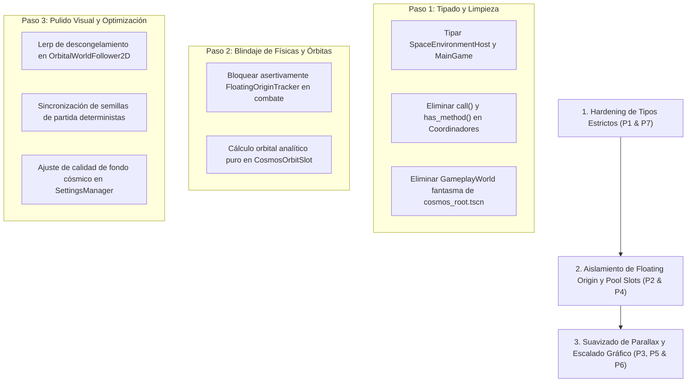

# Diagnóstico Detallado de Problemas y Riesgos Arquitectónicos — Cosmos Engine en MainGame

**Ruta:** `docs/dev/cosmos_engine_architecture_issues.md`  
**Fecha:** 14 de Octubre, 2026  
**Motor:** Godot 4.7.2 · **Milestone:** M7 (Balance Fino)  
**Dominio:** Entorno de Combate, Cosmos Engine, SpaceEnvironmentHost e interoperabilidad con Gameplay.

---

## 📋 Resumen Ejecutivo

Este documento cataloga en profundidad técnica los **7 problemas y puntos de peligro** identificados en la integración de Cosmos Engine en la escena principal de combate ([`main_game.gd`](file:///c:/Users/Frani/.gemini/antigravity/scratch/astra_dream/scenes/combat/main_game.gd) y [`main_game.tscn`](file:///c:/Users/Frani/.gemini/antigravity/scratch/astra_dream/scenes/combat/main_game.tscn)).

Cada problema incluye:
- Archivos y líneas exactas afectadas.
- Diagnóstico de la causa raíz.
- Impacto funcional y técnico en producción.
- Solución recomendada paso a paso.

---

## 1. Duck-Typing Generalizado y Violación del Contrato de Tipado Estricto

* **Severidad:** 🔴 Alta (Inmediata)
* **Archivos Afectados:**
  - [`scenes/combat/environment/space_environment_host.gd`](file:///c:/Users/Frani/.gemini/antigravity/scratch/astra_dream/scenes/combat/environment/space_environment_host.gd) (Líneas 15, 51–56, 72–75, 78–82)
  - [`scenes/combat/main_game.gd`](file:///c:/Users/Frani/.gemini/antigravity/scratch/astra_dream/scenes/combat/main_game.gd) (Línea 38)
  - [`scenes/combat/systems/combat_satellite_coordinator.gd`](file:///c:/Users/Frani/.gemini/antigravity/scratch/astra_dream/scenes/combat/systems/combat_satellite_coordinator.gd) (Líneas 100–115, 221–235, 400–410)
  - [`scenes/combat/environment/planet_spawner.gd`](file:///c:/Users/Frani/.gemini/antigravity/scratch/astra_dream/scenes/combat/environment/planet_spawner.gd) (Líneas 49–65, 300–330)
  - [`scenes/combat/environment/cosmos/core/orbital_world_follower_2d.gd`](file:///c:/Users/Frani/.gemini/antigravity/scratch/astra_dream/scenes/combat/environment/cosmos/core/orbital_world_follower_2d.gd) (Líneas 55–59)
  - [`scenes/combat/environment/gameplay_planet_shadow_caster_2d.gd`](file:///c:/Users/Frani/.gemini/antigravity/scratch/astra_dream/scenes/combat/environment/gameplay_planet_shadow_caster_2d.gd) (Líneas 65–68)

### Diagnóstico de la Causa Raíz
[`docs/COSMIC_GAMEPLAY_BRIDGE.md`](file:///c:/Users/Frani/.gemini/antigravity/scratch/astra_dream/docs/COSMIC_GAMEPLAY_BRIDGE.md) Sección 3 establece explícitamente:
> **PROHIBIDO el uso de `find_child`, `has_method` o llamadas dinámicas con `call()` para comunicarse entre entidades de juego y Cosmos Engine.**
> La vía canónica tipada de acceso es siempre:
> ```gdscript
> var env_host: SpaceEnvironmentHost = main_game.space_environment_host
> var host_ctrl: CosmosHostController = env_host.get_cosmos_controller()
> ```

A pesar de esta directriz:
1. `SpaceEnvironmentHost.active_environment` está declarado como `var active_environment: Node2D = null` en lugar de `BaseSpaceEnvironment`. En consecuencia, usa llamadas dinámicas:
   ```gdscript
   if active_environment.has_method("set_camera_reference") and context.camera:
       active_environment.call("set_camera_reference", context.camera)
   ```
2. `SpaceEnvironmentHost.get_cosmos_controller()` tiene firma `func get_cosmos_controller() -> Node:`, devolviendo `Node` genérico y usando `active_environment.call("get_host_controller")`.
3. En `main_game.gd` (línea 38), la variable es `var environment_host: Node = SpaceEnvironmentHostScript.new()` (tipada como `Node`).
4. Tanto `CombatSatelliteCoordinator` como `PlanetSpawner` implementan una función privada idéntica:
   ```gdscript
   func _get_cosmos_controller() -> Node:
       var env_host: Node = main_game.get_node_or_null("SpaceEnvironmentHost")
       if not env_host and main_game.has_node("SpaceBackground"):
           env_host = main_game.get_node("SpaceBackground")
       if env_host != null and env_host.has_method("get_cosmos_controller"):
           return env_host.call("get_cosmos_controller")
       elif env_host != null and env_host.has_method("get_host_controller"):
           return env_host.call("get_host_controller")
       return null
   ```
5. En `OrbitalWorldFollower2D` y `GameplayPlanetShadowCaster2D`, para localizar la raíz cósmica se ejecuta:
   ```gdscript
   var bg: Node = get_tree().root.find_child("SpaceBackground", true, false)
   if bg != null and bg.has_method("get_cosmos_root"):
       _cosmos_root = bg.call("get_cosmos_root") as CosmosRootNode
   ```

### Impacto
- Bypassea la regla de tipado estricto obligatorio de GDScript 4.7 (Regla Central 4 del proyecto).
- Cualquier cambio de firma, refactor o renombrado en métodos de Cosmos no genera error de compilación ni aviso en tiempo de diseño; fallará de forma silenciosa en runtime, provocando que los satélites y planetas caigan en fallback plano o no se sincronicen.
- `get_tree().root.find_child(..., true, false)` realiza una búsqueda recursiva profunda en todo el árbol de escena de Godot, introduciendo latencia innecesaria en la inicialización de entidades.

### Solución Recomendada
1. En `SpaceEnvironmentHost`:
   - Declarar `var active_environment: BaseSpaceEnvironment = null`.
   - Modificar la firma a `func get_cosmos_controller() -> CosmosHostController:`.
   - En `CosmosCombatEnvironment`, exponer `func get_cosmos_controller() -> CosmosHostController: return host_controller`.
   - Invocar métodos directamente de forma tipada (`active_environment.set_camera_reference(context.camera)`).
2. En `MainGame`:
   - Declarar `var environment_host: SpaceEnvironmentHost = SpaceEnvironmentHostScript.new()`.
3. En `CombatSatelliteCoordinator` y `PlanetSpawner`:
   - Sustituir `_get_cosmos_controller() -> Node` por la ruta canónica tipada:
     ```gdscript
     func _get_cosmos_controller() -> CosmosHostController:
         if main_game and main_game.environment_host:
             return main_game.environment_host.get_cosmos_controller()
         return null
     ```
   - Tipar todas las llamadas a `host_ctrl.get_star_center_slots(...)`, `host_ctrl.get_destructible_planet_slots(...)` sin usar `call()`.
4. En `OrbitalWorldFollower2D` y `GameplayPlanetShadowCaster2D`:
   - Pasar las referencias de `cosmos_root` y `camera` de forma explícita en su método `setup_orbital_binding()`, eliminando `find_child()`.

---

## 2. Peligro Catastrófico: Incompatibilidad de Floating Origin con BulletServer y Entidades

* **Severidad:** 💣 Crítica (Bomba de tiempo latente)
* **Archivos Afectados:**
  - [`scenes/combat/environment/cosmos/core/floating_origin_tracker.gd`](file:///c:/Users/Frani/.gemini/antigravity/scratch/astra_dream/scenes/combat/environment/cosmos/core/floating_origin_tracker.gd) (Líneas 47–73)
  - [`scenes/combat/environment/cosmos/scenes/cosmos_root.gd`](file:///c:/Users/Frani/.gemini/antigravity/scratch/astra_dream/scenes/combat/environment/cosmos/scenes/cosmos_root.gd) (Líneas 26, 81, 238–262, 439–447)
  - [`core/autoloads/bullet_server.gd`](file:///c:/Users/Frani/.gemini/antigravity/scratch/astra_dream/core/autoloads/bullet_server.gd)
  - [`scenes/combat/enemies/enemy_spawner.gd`](file:///c:/Users/Frani/.gemini/antigravity/scratch/astra_dream/scenes/combat/enemies/enemy_spawner.gd)

### Diagnóstico de la Causa Raíz
`CosmosFloatingOriginTracker` fue diseñado para el sandbox de exploración infinita. Cuando `player_target` se aleja más de `threshold_distance = 10000.0` px del origen $(0,0)$, ejecuta `trigger_shift(shift)`:
```gdscript
func trigger_shift(shift: Vector2) -> void:
    if is_instance_valid(player_target):
        player_target.global_position -= shift
    if is_instance_valid(camera):
        camera.global_position -= shift
    for layer: Parallax2D in parallax_layers:
        layer.scroll_offset -= shift * layer.scroll_scale
    origin_shifted.emit(shift)
```
En `cosmos_root.gd` existen miembros activos preparados para albergar este tracker:
- `@export var floating_origin_tracker: CosmosFloatingOriginTracker`
- `_setup_floating_origin()`
- `_on_floating_origin_shifted(shift)`

### Impacto
- **`MainGame` no es compatible con translaciones de origen flotante:**
  1. `BulletServer` procesa miles de balas usando un array contiguo (`PackedFloat32Array`) con posiciones globales absolutas fijas. Al trasladar al jugador y la cámara por 10,000 unidades, las balas en vuelo quedan a 10,000 píxeles de distancia instantáneamente, arruinando los patrones danmaku.
  2. Los enemigos activos (`EnemySpawner`), jefes (`CombatBossCoordinator`), drops de experiencia, monolitos, cofres y satélites **no se trasladan**, quedando desfasados y desapareciendo de la vista del jugador en un solo cuadro.
- **Estado actual:** Por seguridad, `floating_origin_tracker` **no** está instanciado en el `.tscn` de producción (`scenes/combat/environment/cosmos/scenes/cosmos_root.tscn`). Sin embargo, su código sigue presente en `cosmos_root.gd` y se prueba activamente en suites de sandbox. Si un desarrollador o agente asume que el sistema está listo y añade el nodo a `cosmos_root.tscn`, colapsará la partida tras volar 10,000 unidades.

### Solución Recomendada
1. En `cosmos_root.gd`, añadir una guarda estricta o aserto:
   ```gdscript
   func _setup_floating_origin() -> void:
       if floating_origin_tracker != null:
           push_warning("CosmosRootNode: FloatingOriginTracker está deshabilitado en combate debido a la arquitectura fija de BulletServer.")
           floating_origin_tracker = null
   ```
2. Mantener la lógica de floating origin aislada formalmente en `sandbox/` hasta que `BulletServer` y `EnemySpawner` implementen soporte para traslación vectorial masiva.

---

## 3. Desincronización y "Snapping" en `OrbitalWorldFollower2D`

* **Severidad:** ⚡ Alta (Problema visual y de posicionamiento)
* **Archivos Afectados:**
  - [`scenes/combat/environment/cosmos/core/orbital_world_follower_2d.gd`](file:///c:/Users/Frani/.gemini/antigravity/scratch/astra_dream/scenes/combat/environment/cosmos/core/orbital_world_follower_2d.gd) (Líneas 16–28, 101–118)
  - [`scenes/combat/systems/combat_satellite_coordinator.gd`](file:///c:/Users/Frani/.gemini/antigravity/scratch/astra_dream/scenes/combat/systems/combat_satellite_coordinator.gd) (Líneas 199–202)
  - [`scenes/combat/environment/cosmos/resources/data/default_cosmos_environment.tres`](file:///c:/Users/Frani/.gemini/antigravity/scratch/astra_dream/scenes/combat/environment/cosmos/resources/data/default_cosmos_environment.tres) (Línea 14)

### Diagnóstico de la Causa Raíz
La proyección analítica de un slot de Parallax al mundo de juego se rige por:
$$\text{new\_world\_pos} = \left(\text{cam\_pos} \cdot (1 - \text{layer\_scroll\_scale})\right) + \text{layer\_pos}$$
Cuando el jugador se acerca a un satélite o estación a menos de 450 px, `CombatSatelliteCoordinator` congela el arrastre por paralaje para permitir interactuar con la baliza sin que la cámara la desplace:
```gdscript
follower.freeze_parallax_drag = (dist_to_sat < 450.0 or is_in_perimeter or is_charging or is_busy)
```
Al congelarse, `cam_pos` se fija a `_frozen_camera_pos`.
Cuando el jugador sale del radio (> 450 px) o la estación se descarga:
`freeze_parallax_drag` pasa a `false`.

### Impacto
- En el perfil por defecto actual, `solar_scroll_scale = Vector2(1.0, 1.0)`, lo cual anula el término $(1 - 1.0) = 0$, ocultando el problema en el setup estándar.
- **Sin embargo**, si un diseñador edita `default_cosmos_environment.tres` para dar mayor profundidad a los sistemas solares (ej. `solar_scroll_scale = Vector2(0.25, 0.25)`):
  - Mientras el jugador se mueve en el rango de 450 px, la estación permanece fija respecto a `_frozen_camera_pos`.
  - En el instante exacto en que cruza los 451 px, `cam_pos` salta a la posición real actual de la cámara, provocando un **teletransporte instantáneo (snapping)** del satélite:
    $$\Delta P = (\text{cam\_pos} - \text{frozen\_pos}) \cdot (1 - 0.25)$$
  - Esto descoloca la nave, interrumpe el área de recolección y causa confusión visual severa.

### Solución Recomendada
1. En `OrbitalWorldFollower2D`, implementar una interpolación de transición suave (tween o `lerpf` durante 0.4s) al descongelar `freeze_parallax_drag`:
   ```gdscript
   var _blend_weight: float = 0.0 # 0.0 = frozen, 1.0 = real cam
   ```
2. Garantizar que si `slot.layer_scroll_scale == Vector2.ONE`, se desactive completamente el cómputo de `freeze_parallax_drag` por ser matemáticamente innecesario.

---

## 4. Reciclaje del Object Pool y Referencias Huérfanas en `CosmosOrbitSlot`

* **Severidad:** 🔄 Media-Alta
* **Archivos Afectados:**
  - [`scenes/combat/environment/cosmos/core/solar_system_streamer.gd`](file:///c:/Users/Frani/.gemini/antigravity/scratch/astra_dream/scenes/combat/environment/cosmos/core/solar_system_streamer.gd) (Líneas 141–173)
  - [`scenes/combat/environment/cosmos/core/cosmos_orbit_slot.gd`](file:///c:/Users/Frani/.gemini/antigravity/scratch/astra_dream/scenes/combat/environment/cosmos/core/cosmos_orbit_slot.gd) (Líneas 47–56)
  - [`scenes/combat/environment/cosmos/core/solar_system_2d.gd`](file:///c:/Users/Frani/.gemini/antigravity/scratch/astra_dream/scenes/combat/environment/cosmos/core/solar_system_2d.gd) (Líneas 59–75)

### Diagnóstico de la Causa Raíz
`CosmosSolarSystemStreamer` reutiliza 8 instancias fijas de `CosmosSolarSystem2D` mediante un pool (`_pool`).
Cuando una celda sale del frustum de la cámara:
1. El sistema se marca `sys.visible = false` y se reincorpora al array `_pool`.
2. Los nodos hijos de la estrella y planetas del sistema siguen vivos en memoria (`is_instance_valid(sys.star_body) == true`).
3. Cuando otra celda entra en pantalla, toma el sistema del pool y le asigna una nueva posición: `sys.position = get_system_position_for_cell(req_cell)` (que puede estar a 50,000 px de la anterior).
4. Luego ejecuta `build_system()`, donde llama a `_clear_existing_system()`, aplicando `remove_child(child)` y `child.queue_free()`.

En `CosmosOrbitSlot`, la función de cálculo de posición es:
```gdscript
func calculate_layer_position(global_time: float) -> Vector2:
    var rel_orbit: Vector2 = CosmosKeplerOrbitMath.calculate_orbit_position(orbit_radius, initial_phase, angular_velocity, global_time)
    if is_instance_valid(body_reference):
        var curr: Node = body_reference
        var body_layer_pos: Vector2 = Vector2.ZERO
        while curr is Node2D and not (curr is CosmosSolarSystemStreamer) and not (curr is Parallax2D):
            body_layer_pos += (curr as Node2D).position
            curr = curr.get_parent()
        return body_layer_pos + rel_orbit

    # Fallback puramente matemático si el nodo fue liberado
    return center_layer_position + rel_orbit
```

### Impacto
- `queue_free()` de Godot **no invalida inmediatamente** `is_instance_valid()`; la instancia sigue viva hasta el final del fotograma.
- Si una entidad de juego (satélite o planeta destruible) retiene un slot cuyo sistema solar fue unstreamed y reasignado a otra celda lejana en el pool:
  - Durante ese fotograma, `curr.get_parent().position` reflejará la **nueva celda lejana**, produciendo un tirón (glitch visual) de un frame donde el satélite salta miles de píxeles y regresa al frame siguiente cuando el fallback toma el control.
  - Además, en el fallback matemático `center_layer_position + rel_orbit`, si el slot correspondía a un planeta móvil y no a una estrella estática, `center_layer_position` solo capturó la posición en el instante de creación, perdiendo la órbita acumulada del planeta anfitrión.

### Solución Recomendada
1. En `CosmosSolarSystemStreamer`, al desasociar un sistema solar (`cells_to_release`):
   - Notificar al slot o desvincular inmediatamente `body_reference = null` de los slots asociados para forzar la evaluación analítica determinista pura.
2. En `CosmosOrbitSlot`, almacenar los parámetros orbitales del cuerpo anfitrión (radio kepleriano, fase inicial, velocidad angular del planeta padre respecto al sol) para que el fallback analítico sea exacto en todo instante $t$, sin depender de nodos `Node2D` del árbol de escena.

---

## 5. Desfase de Ciclo de Vida en `_ready()` y Semillas Efímeras

* **Severidad:** ⏱️ Media
* **Archivos Afectados:**
  - [`scenes/combat/environment/cosmos_combat_environment.gd`](file:///c:/Users/Frani/.gemini/antigravity/scratch/astra_dream/scenes/combat/environment/cosmos_combat_environment.gd) (Líneas 36–40, 43–46)
  - [`scenes/combat/systems/combat_bootstrapper.gd`](file:///c:/Users/Frani/.gemini/antigravity/scratch/astra_dream/scenes/combat/systems/combat_bootstrapper.gd) (Líneas 144–173)
  - [`scenes/combat/main_game.tscn`](file:///c:/Users/Frani/.gemini/antigravity/scratch/astra_dream/scenes/combat/main_game.tscn) (Línea 31)

### Diagnóstico de la Causa Raíz
En el árbol de escena de Godot, los nodos hijos ejecutan su `_ready()` antes que el nodo padre.
`SpaceBackground` es un hijo directo pre-colocado en `main_game.tscn`.
1. `SpaceBackground` ejecuta `CosmosCombatEnvironment._ready()`.
2. Al estar activa la bandera `@export var randomize_seed_on_ready: bool = true`, llama a `randomize_environment_seed()`.
3. Esto genera un número aleatorio `randi()` y propaga la semilla a `CosmosRootNode.set_run_seed()`, la cual reconstruye los grids de galaxias, debris y sistemas solares.
4. Posteriormente, `MainGame._ready()` arranca y llama a `CombatBootstrapper.launch_session()`.

### Impacto
- Si la partida es una restauración de partida guardada en curso (`SaveManager.is_resuming_run`), o un modo de desafío diario con semilla fija, el entorno ya consumió ciclos de CPU generando el cosmos con una semilla aleatoria incorrecta.
- Obliga a realizar una segunda regeneración inmediata cuando se aplica la semilla canónica de la partida, duplicando la inicialización en el primer frame.
- Durante el `_ready()` de Cosmos, `player` y `camera` son `null`, por lo que las comprobaciones iniciales de celdas no tienen información del visor hasta que `CombatBootstrapper` enlaza las referencias vía diferida.

### Solución Recomendada
1. En `cosmos_combat_environment.tscn`, cambiar el valor exportado a `randomize_seed_on_ready = false`.
2. Permitir que `CombatBootstrapper` sea la única fuente de verdad, asignando la semilla de partida (`run_seed`) al orquestador cósmico durante `launch_session()` antes de disparar el primer streaming de celdas.

---

## 6. Presupuesto de GPU, Fillrate y Textura 8K en GPUs Integradas

* **Severidad:** 🎨 Media
* **Archivos Afectados:**
  - [`scenes/combat/environment/cosmos/shaders/universe_nebula.gdshader`](file:///c:/Users/Frani/.gemini/antigravity/scratch/astra_dream/scenes/combat/environment/cosmos/shaders/universe_nebula.gdshader)
  - [`scenes/combat/environment/cosmos/shaders/deep_starfield.gdshader`](file:///c:/Users/Frani/.gemini/antigravity/scratch/astra_dream/scenes/combat/environment/cosmos/shaders/deep_starfield.gdshader)
  - [`assets/environments/parallax_space/deep_starfield_8k.png`](file:///c:/Users/Frani/.gemini/antigravity/scratch/astra_dream/assets/environments/parallax_space/deep_starfield_8k.png)
  - [`scenes/combat/environment/cosmos/scenes/cosmos_root.tscn`](file:///c:/Users/Frani/.gemini/antigravity/scratch/astra_dream/scenes/combat/environment/cosmos/scenes/cosmos_root.tscn)

### Diagnóstico de la Causa Raíz
El fondo cósmico está compuesto por:
1. `ParallaxNebulaDeep/NebulaBackdrop`: Un `ColorRect` en `CanvasLayer` (layer -100) que cubre el 100% de la pantalla (1920x1080 o superior). Su fragment shader evalúa:
   - Ruido Simplex FBM en GPU.
   - Dispersión cromática angular.
   - Muestreo bilineal continuo de la textura `deep_starfield_8k.png` (8192x8192).
   - Muestreo de la textura seamless de nebulosa (`nebula_seamless_0.png`).
   - Un bucle de hasta 4 fuentes de luz estelar analíticas con atenuación cuadrática y smoothstep por cada píxel.
2. `CanvasLayerStarfield/StarfieldBackdrop`: Otro `ColorRect` a pantalla completa en layer -105 que vuelve a muestrear la textura 8K para calcular lens flares y centelleo estelar.

### Impacto
- En GPUs dedicadas de escritorio (RTX/Radeon), el impacto es despreciable (<0.8 ms).
- En GPUs integradas (Intel Iris Xe, AMD Vega, Steam Deck) o resoluciones 1440p/4K:
  - El consumo de ancho de banda de memoria de la textura sin comprimir de 8192x8192 (~256 MB) compite con los búferes de renderizado.
  - El alto costo aritmético por fragmento satura el pipeline de rasterizado de la GPU.
  - Si el framerate cae por debajo de 60 FPS, la acumulación física de proyectiles masivos de `BulletServer` puede experimentar saltos o degradación de la experiencia de juego.

### Solución Recomendada
1. En `SettingsManager`, vincular un ajuste de calidad de fondo espacial ("Fondo Espacial: Alto / Medio / Bajo").
2. En perfiles de bajo consumo o Steam Deck:
   - Apagar el shader secundario de `CanvasLayerStarfield` (layer -105), apoyándose únicamente en el lecho estelar integrado en `universe_nebula.gdshader`.
   - Reducir el número de octavas del FBM o la resolución interna del viewport de la nebulosa a la mitad (960x540) renderizada sobre una textura con interpolación bilineal.

---

## 7. Dualidad de Planetas y Nodo Fantasma `GameplayWorld`

* **Severidad:** 🧩 Baja-Medio (Higiene Arquitectónica)
* **Archivos Afectados:**
  - [`scenes/combat/environment/planet_spawner.gd`](file:///c:/Users/Frani/.gemini/antigravity/scratch/astra_dream/scenes/combat/environment/planet_spawner.gd) (Líneas 66–92, 312–346)
  - [`scenes/combat/environment/cosmos/core/solar_system_2d.gd`](file:///c:/Users/Frani/.gemini/antigravity/scratch/astra_dream/scenes/combat/environment/cosmos/core/solar_system_2d.gd)
  - [`scenes/combat/environment/cosmos/scenes/cosmos_root.tscn`](file:///c:/Users/Frani/.gemini/antigravity/scratch/astra_dream/scenes/combat/environment/cosmos/scenes/cosmos_root.tscn) (Línea 140)

### Diagnóstico de la Causa Raíz
1. **Dualidad Planetaria:** Existen dos conceptos de planetas que operan de forma semi-independiente:
   - `CosmosSolarSystem2D` genera planetas decorativos de fondo no colisionables con shaders procedurales y ciclo día/noche.
   - `PlanetSpawner` genera nodos `Planet` físicos con colisiones, vida y drops. Aunque intenta anclarse a slots de Cosmos vía `_apply_star_orbit_binding`, si no hay un slot disponible recurre a su spawner de distancia acumulada tradicional (`spawn_distance_interval = 7000.0`), generando planetas en el vacío sin correspondencia con ningún sol del fondo.
2. **Nodo Fantasma `GameplayWorld`:**
   En `cosmos_root.tscn`:
   ```text
   [node name="GameplayWorld" type="Node2D" parent="." unique_id=123479881]
   ```
   Este nodo fue heredado del prototipo del sandbox donde el jugador era hijo de CosmosRoot. En combate de producción, `MainGame` aloja directamente a `Player`, `BulletServer`, `Enemies` y demás entidades físicas. El nodo `GameplayWorld` dentro de `CosmosRoot` permanece vacío e inerte durante toda la partida.

### Impacto
- El nodo fantasma crea confusión cognitiva sobre la jerarquía de capas y propiedad de nodos.
- La dualidad de planetas crea inconsistencia estética: a veces hay sistemas solares completos sin planetas físicos colisionables, y a veces planetas destruibles flotando en la nada sin estrella anfitriona.

### Solución Recomendada
1. Eliminar el nodo `GameplayWorld` de `cosmos_root.tscn` y remover su exportación `@export var gameplay_world: Node2D` en `cosmos_root.gd`.
2. Alinear `PlanetSpawner` para que la aparición de planetas destruibles esté 100% coordinada con el evento `solar_system_streamed` de Cosmos Engine, garantizando que cada planeta destruible orbite visualmente una estrella visible en el fondo.

---

## 🎯 Plan de Remediación Sugerido



---
*Documento generado para el equipo de desarrollo de Astra Dream.*
