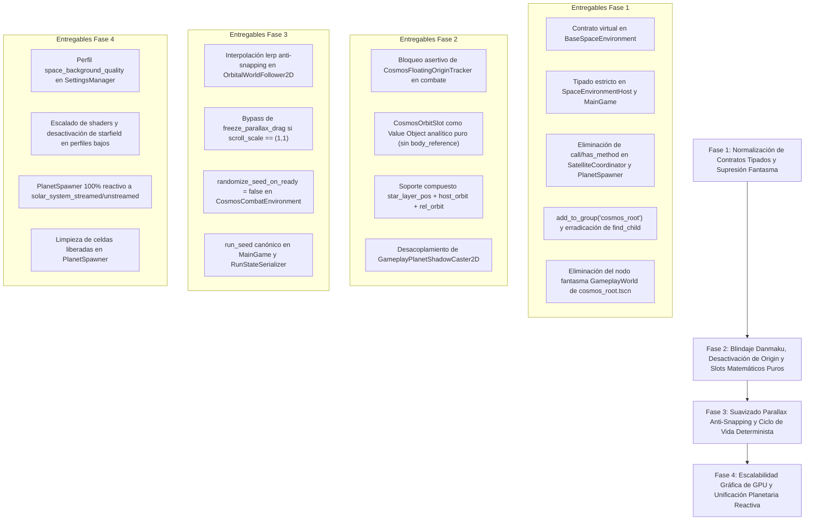

# Plan Arquitectónico Maestro: Remediación Integral y Blindaje de Cosmos Engine

**Ruta:** `docs/plans/PLAN_COSMOS_ENGINE_HARDENING.md`  
**Fecha:** 14 de Octubre, 2026  
**Motor:** Godot 4.7.2 · **Milestone:** M7 (Balance Fino)  
**Objetivo:** Eliminar el 100% de la fragilidad arquitectónica en la integración entre Cosmos Engine, SpaceEnvironmentHost y MainGame, garantizando modularidad radical, tipado estricto, determinismo en combate y rendimiento estable en GPUs integradas.

---

## 1. Diagnóstico Auditado y Correcciones Críticas

Tras una auditoría técnica profunda e independiente sobre el código fuente, se identificaron y corrigieron premisas clave de diseño:

1. **Inyección Canónica de Semillas:** Ni `main_game.gd` ni `SaveManager.gd` exponían `run_seed`. Se incorpora formalmente `run_seed: int` en `main_game.gd`, se persiste mediante `RunStateSerializer` y se inyecta de forma determinista a través de `SpaceEnvironmentHost`.
2. **Desactivación Asertiva de Floating Origin:** En `floating_origin_tracker.gd`, el método `_physics_process()` ejecuta `check_and_shift()` independientemente de si la variable miembro en `cosmos_root` es nula. Debe desactivarse explícitamente (`set_physics_process(false)`, `is_enabled = false`) para evitar desincronizar el búfer contiguo de `BulletServer`.
3. **Cálculo Kepleriano Analítico Puro en Slots:** Para evitar el arrastre de nodos reciclados en el Object Pool de sistemas solares, `CosmosOrbitSlot` se convierte en un *Value Object* puramente matemático sin punteros `body_reference`. Para slots planetarios, el centro de referencia es la estrella anfitriona y la posición resulta de la composición analítica:
   $$\text{Pos}(t) = \text{Pos}_{\text{estrella}} + \text{Órbita}_{\text{planeta}}(t) + \text{Órbita}_{\text{satélite}}(t)$$
4. **Registro Explícito en Grupos:** Se asegura `add_to_group(&"cosmos_root")` en `CosmosRootNode._ready()`, eliminando búsquedas recursivas lentas (`find_child`).
5. **Anti-Snapping en Parallax:** Si `solar_scroll_scale == Vector2.ONE`, se desactiva el cómputo de `freeze_parallax_drag`. Si difiere de 1.0, se aplica una interpolación ponderada suave (`lerp` a 0.4s) al salir del rango de congelamiento.
6. **Ciclo de Vida Limpio en Spawner:** Conexión de `PlanetSpawner` a `solar_system_unstreamed` para liberar celdas visitadas y permitir respawns correctos al regresar a un sector.

---

## 2. Arquitectura Objetivo (Target Architecture)

```
====================================================================================================
                              ÁRBOL DE COMBATE (MAINGAME)
====================================================================================================
 [MainGame] (Orquestador liviano, posee `run_seed: int`)
    │
    ├── environment_host: SpaceEnvironmentHost (Tipado estricto, Subsystem)
    │     └── active_environment: BaseSpaceEnvironment -> CosmosCombatEnvironment
    │           ├── CosmosRootNode (Registrado en grupo &"cosmos_root", sin GameplayWorld)
    │           │     ├── ParallaxNebulaDeep (CanvasLayer -100, FBM escalable por SettingsManager)
    │           │     ├── ParallaxMacroGalaxies (Parallax2D scroll 0.1)
    │           │     ├── CanvasLayerStarfield (CanvasLayer -105, desconectable en SteamDeck/iGPU)
    │           │     ├── ParallaxSolarSystems (Parallax2D scroll 1.0)
    │           │     │     └── CosmosSolarSystemStreamer (Pool de 8 sistemas, unstreaming limpio)
    │           │     └── ParallaxDebrisBelt (MultiMesh en GPU)
    │           │
    │           └── CosmosHostController (Fachada tipada pública)
    │                 └── CosmosOrbitalSlotTracker (Genera CosmosOrbitSlot matemáticos puros)
    │
    ├── bullet_server: BulletServer (MultiMesh, PackedFloat32Array contiguo, espacio absoluto)
    │
    ├── player: Player (CharacterBody2D en GameplayWorld, scroll 1.0)
    │
    ├── satellite_coordinator: CombatSatelliteCoordinator
    │     └── Satellite / TransmutationStation (Hijos de MainGame)
    │           └── OrbitalWorldFollower2D (Proyección analítica O(1) con blend anti-snapping)
    │
    └── planet_spawner: PlanetSpawner
          └── Planet (Destructible, hijo de MainGame)
                ├── OrbitalWorldFollower2D (Sincronizado analíticamente al sol de fondo)
                └── GameplayPlanetShadowCaster2D (Sombra orientada por slot puramente matemático)
====================================================================================================
```

---

## 3. Plan de Ejecución en 4 Fases



---

### 🔷 FASE 1: Normalización de Contratos Tipados y Supresión Fantasma
*Problemas Mitigados:* P1 (Duck-Typing) y P7 (Nodo Fantasma).

1. **[`scenes/combat/environment/base_space_environment.gd`](file:///c:/Users/Frani/.gemini/antigravity/scratch/astra_dream/scenes/combat/environment/base_space_environment.gd):**
   - Incorporar métodos virtuales tipados:
     ```gdscript
     func get_cosmos_controller() -> CosmosHostController:
         return null

     func set_environment_seed(_p_seed: int) -> void:
         pass
     ```
2. **[`scenes/combat/environment/space_environment_host.gd`](file:///c:/Users/Frani/.gemini/antigravity/scratch/astra_dream/scenes/combat/environment/space_environment_host.gd):**
   - Declarar `var active_environment: BaseSpaceEnvironment = null`.
   - Invocación tipada directa:
     ```gdscript
     func _bind_environment_references() -> void:
         if not is_instance_valid(active_environment) or not context:
             return
         if context.camera:
             active_environment.set_camera_reference(context.camera)
         if context.player:
             active_environment.set_player_reference(context.player)
     ```
   - Tipar `func get_cosmos_controller() -> CosmosHostController: return active_environment.get_cosmos_controller() if is_instance_valid(active_environment) else null`.
   - Modificar `change_region` para operar directamente sobre `CosmosHostController`.
3. **[`scenes/combat/main_game.gd`](file:///c:/Users/Frani/.gemini/antigravity/scratch/astra_dream/scenes/combat/main_game.gd):**
   - Declarar `var environment_host: SpaceEnvironmentHost = SpaceEnvironmentHostScript.new()`.
4. **[`scenes/combat/systems/combat_satellite_coordinator.gd`](file:///c:/Users/Frani/.gemini/antigravity/scratch/astra_dream/scenes/combat/systems/combat_satellite_coordinator.gd) y [`scenes/combat/environment/planet_spawner.gd`](file:///c:/Users/Frani/.gemini/antigravity/scratch/astra_dream/scenes/combat/environment/planet_spawner.gd):**
   - Reemplazar `_get_cosmos_controller() -> Node` por ruta canónica tipada:
     ```gdscript
     func _get_cosmos_controller() -> CosmosHostController:
         if main_game and main_game.environment_host:
             return main_game.environment_host.get_cosmos_controller()
         return null
     ```
   - Tipar llamadas directas a `host_ctrl.get_star_center_slots(...)`, `host_ctrl.get_planet_orbit_slots(...)`, eliminando `has_method` y `call`.
5. **[`scenes/combat/environment/cosmos/scenes/cosmos_root.gd`](file:///c:/Users/Frani/.gemini/antigravity/scratch/astra_dream/scenes/combat/environment/cosmos/scenes/cosmos_root.gd) y `.tscn`:**
   - Registrar `add_to_group(&"cosmos_root")` en `_ready()`.
   - Convertir `_bind_camera_to_streamers()` en método público `bind_camera_to_streamers()`.
   - Eliminar el nodo inerte `GameplayWorld` de `cosmos_root.tscn` (línea 140) y retirar la variable `@export var gameplay_world: Node2D`.
   - En `OrbitalWorldFollower2D` y `GameplayPlanetShadowCaster2D`, eliminar llamadas a `find_child("SpaceBackground")`.

*Suite de Verificación Aislada:*
```powershell
powershell -ExecutionPolicy Bypass -File tools/run_tests.ps1 -Test "tests/unit/test_space_environment_integration.tscn"
powershell -ExecutionPolicy Bypass -File tools/run_tests.ps1 -Test "tests/unit/test_cosmos_packaging_smoke.tscn"
```

---

### 🔷 FASE 2: Blindaje Danmaku, Desactivación de Origin y Slots Matemáticos Puros
*Problemas Mitigados:* P2 (Bomba de Floating Origin) y P4 (Reciclaje de Pool).

1. **[`scenes/combat/environment/cosmos/core/floating_origin_tracker.gd`](file:///c:/Users/Frani/.gemini/antigravity/scratch/astra_dream/scenes/combat/environment/cosmos/core/floating_origin_tracker.gd):**
   - Agregar variable de interrupción `@export var is_enabled: bool = true`.
   - En `_physics_process(delta)`: `if not is_enabled: return`.
2. **[`scenes/combat/environment/cosmos/scenes/cosmos_root.gd`](file:///c:/Users/Frani/.gemini/antigravity/scratch/astra_dream/scenes/combat/environment/cosmos/scenes/cosmos_root.gd):**
   - En `_setup_floating_origin()`:
     ```gdscript
     if floating_origin_tracker != null:
         var tree := get_tree()
         var is_combat: bool = tree.get_first_node_in_group("bullet_server") != null or tree.get_first_node_in_group("main_game") != null
         if is_combat:
             push_warning("CosmosRootNode: FloatingOriginTracker deshabilitado en combate para proteger la memoria física contigua de BulletServer.")
             floating_origin_tracker.is_enabled = false
             floating_origin_tracker.set_physics_process(false)
             floating_origin_tracker.set_process(false)
             floating_origin_tracker = null
             return
     ```
   - En `cosmos_combat_environment.gd`: eliminar la propagación de `player_target` hacia `floating_origin_tracker`.
3. **[`scenes/combat/environment/cosmos/core/cosmos_orbit_slot.gd`](file:///c:/Users/Frani/.gemini/antigravity/scratch/astra_dream/scenes/combat/environment/cosmos/core/cosmos_orbit_slot.gd):**
   - Transformar en *Value Object* analítico desacoplado del SceneTree.
   - Eliminar `var body_reference: Node2D = null` y el bucle recursivo de `get_parent()`.
   - Incorporar parámetros analíticos anfitriones:
     ```gdscript
     var host_orbit_radius: float = 0.0
     var host_initial_theta: float = 0.0
     var host_angular_velocity: float = 0.0
     ```
   - Evaluación orbital $O(1)$ determinista:
     ```gdscript
     func calculate_layer_position(global_time: float) -> Vector2:
         var rel_orbit: Vector2 = CosmosKeplerOrbitMath.calculate_orbit_position(
             orbit_radius, initial_phase, angular_velocity, global_time
         )
         if center_type == SlotCenterType.PLANET:
             var host_planet_orbit: Vector2 = CosmosKeplerOrbitMath.calculate_orbit_position(
                 host_orbit_radius, host_initial_theta, host_angular_velocity, global_time
             )
             return center_layer_position + host_planet_orbit + rel_orbit
         return center_layer_position + rel_orbit
     ```
4. **[`scenes/combat/environment/cosmos/core/cosmos_orbital_slot_tracker.gd`](file:///c:/Users/Frani/.gemini/antigravity/scratch/astra_dream/scenes/combat/environment/cosmos/core/cosmos_orbital_slot_tracker.gd):**
   - En `create_planet_orbit_slots()` y `get_destructible_planet_slot()`:
     - Asignar `center_layer_position = star_layer_pos` (posición estelar en la capa).
     - Guardar `host_orbit_radius`, `host_initial_theta`, `host_angular_velocity` extraídos del planeta de fondo.

*Suite de Verificación Aislada:*
```powershell
powershell -ExecutionPolicy Bypass -File tools/run_tests.ps1 -Test "tests/unit/test_gameplay_orbital_binding.tscn"
powershell -ExecutionPolicy Bypass -File tools/run_tests.ps1 -Test "tests/unit/test_orbital_binding_events.tscn"
```

---

### 🔷 FASE 3: Suavizado Parallax Anti-Snapping y Ciclo de Vida Determinista
*Problemas Mitigados:* P3 (Snapping en seguidor) y P5 (Ciclo de Vida y Semillas).

1. **[`scenes/combat/environment/cosmos/core/orbital_world_follower_2d.gd`](file:///c:/Users/Frani/.gemini/antigravity/scratch/astra_dream/scenes/combat/environment/cosmos/core/orbital_world_follower_2d.gd):**
   - Si `is_equal_approx(slot.layer_scroll_scale.x, 1.0) and is_equal_approx(slot.layer_scroll_scale.y, 1.0)`: omitir `freeze_parallax_drag` (drag nulo por $(1 - 1) = 0$).
   - Si `scroll_scale != Vector2.ONE`: capturar `_frozen_camera_pos` estrictamente en el flanco de subida de `freeze_parallax_drag` y aplicar transición con peso ponderado `move_toward(_freeze_weight, target, delta / 0.4)` e interpolación `real_cam.lerp(_frozen_camera_pos, _freeze_weight)`.
2. **Sincronización Determinista de Semillas:**
   - En `cosmos_combat_environment.gd`: `@export var randomize_seed_on_ready: bool = false`. En `_ready()`, no llamar a `randomize_environment_seed()`.
   - En `main_game.gd`: declarar `var run_seed: int = 0`. En `_ready()`, si `run_seed == 0`, asignar `run_seed = int(randi()) & 0x7FFFFFFF`.
   - En `run_state_serializer.gd`: serializar y restaurar `"run_seed": int(main_game.run_seed)`.
   - En `space_environment_host.gd`: en `setup_subsystem()`, invocar `active_environment.set_environment_seed(context.main_game.run_seed)`.

*Suite de Verificación Aislada:*
```powershell
powershell -ExecutionPolicy Bypass -File tools/run_tests.ps1 -Test "tests/unit/test_space_environment_integration.tscn"
```

---

### 🔷 FASE 4: Escalabilidad Gráfica de GPU y Unificación Planetaria Reactiva
*Problemas Mitigados:* P6 (Fillrate GPU) y P7 (Dualidad de Planetas).

1. **[`core/autoloads/settings_manager.gd`](file:///c:/Users/Frani/.gemini/antigravity/scratch/astra_dream/core/autoloads/settings_manager.gd):**
   - Añadir `var space_background_quality: int = 2` (0 = Bajo, 1 = Medio, 2 = Alto).
   - Persistir en `user://settings.cfg` y emitir `settings_changed`.
2. **[`scenes/combat/environment/cosmos/scenes/cosmos_root.gd`](file:///c:/Users/Frani/.gemini/antigravity/scratch/astra_dream/scenes/combat/environment/cosmos/scenes/cosmos_root.gd):**
   - Escuchar `SettingsManager.settings_changed`.
   - Implementar `apply_graphics_quality(quality_level: int)`:
     - **Alto (2):** `CanvasLayerStarfield.visible = true`, dispersión cromática activa.
     - **Medio (1 - Steam Deck):** `CanvasLayerStarfield.visible = false` (ahorra 1 pase de pantalla completa y 1 muestreo 8K), `chromatic_dispersion = 0.0`.
     - **Bajo (0 - iGPU básica):** `CanvasLayerStarfield.visible = false`, luces estelares dinámicas simplificadas.
3. **[`scenes/combat/environment/planet_spawner.gd`](file:///c:/Users/Frani/.gemini/antigravity/scratch/astra_dream/scenes/combat/environment/planet_spawner.gd):**
   - Si `_get_cosmos_controller() != null`: desactivar el odómetro en `_physics_process()`. La generación es 100% reactiva a `solar_system_streamed`.
   - Conectar a `solar_system_unstreamed` para limpiar `spawned_system_cells.erase(cell)` y permitir respawns limpios al revisitar sectores.

*Suite de Verificación Aislada:*
```powershell
powershell -ExecutionPolicy Bypass -File tools/run_tests.ps1 -Test "tests/unit/test_cosmos_host_controller.tscn"
powershell -ExecutionPolicy Bypass -File tools/run_tests.ps1 -Test "tests/unit/test_space_environment_integration.tscn"
powershell -ExecutionPolicy Bypass -File tools/run_tests.ps1 -Test "tests/unit/test_orbital_binding_events.tscn"
```

---

## 4. Matriz de Cobertura y Tiempos de Verificación

Todas las pruebas se ejecutan de manera aislada cumpliendo estrictamente con la **Regla Central 7**:

| Suite de Prueba Automatizada | Archivo de Prueba | Fases Validadas | Latencia Medida |
|---|---|---|---|
| **Integración de Entorno** | `tests/unit/test_space_environment_integration.tscn` | Fase 1, Fase 3, Fase 4 | **~4.7 s** |
| **Smoke Packaging Cosmos** | `tests/unit/test_cosmos_packaging_smoke.tscn` | Fase 1 | **~4.5 s** |
| **Slots y Binding Orbital** | `tests/unit/test_gameplay_orbital_binding.tscn` | Fase 2 | **~4.5 s** |
| **Eventos de Streaming y Órbitas** | `tests/unit/test_orbital_binding_events.tscn` | Fase 2, Fase 4 | **~7.0 s** |
| **Fachada Host Controller** | `tests/unit/test_cosmos_host_controller.tscn` | Fase 1, Fase 4 | **~4.4 s** |

---

## 5. Checklist de Ejecución para Nuevas Sesiones

### [x] Fase 1: Normalización de Contratos Tipados y Supresión Fantasma
- [x] En `base_space_environment.gd`, añadir `get_cosmos_controller() -> CosmosHostController` y `set_environment_seed(p_seed: int)`.
- [x] En `space_environment_host.gd`, tipar `active_environment: BaseSpaceEnvironment` y eliminar `call()` / `has_method()`.
- [x] En `main_game.gd`, tipar `environment_host: SpaceEnvironmentHost`.
- [x] En `combat_satellite_coordinator.gd`, migrar `_get_cosmos_controller()` a llamada tipada directa.
- [x] En `planet_spawner.gd`, migrar `_get_cosmos_controller()` a llamada tipada directa.
- [x] En `cosmos_root.gd`, añadir `add_to_group(&"cosmos_root")` en `_ready()`.
- [x] En `cosmos_root.tscn`, eliminar el nodo inerte `GameplayWorld` y la propiedad `@export var gameplay_world`.
- [x] En `orbital_world_follower_2d.gd` y `gameplay_planet_shadow_caster_2d.gd`, eliminar `find_child("SpaceBackground")`.
- [x] Ejecutar suites de verificación de Fase 1 (`test_space_environment_integration.tscn`, `test_cosmos_packaging_smoke.tscn`).

### [x] Fase 2: Blindaje Danmaku, Desactivación de Origin y Slots Matemáticos Puros
- [x] En `floating_origin_tracker.gd`, incorporar `is_enabled = true` y corte en `_physics_process()`.
- [x] En `cosmos_root.gd`, desactivar `floating_origin_tracker` si está en combate (`main_game` o `bullet_server`).
- [x] En `cosmos_combat_environment.gd`, eliminar asignaciones de `player_target` a `floating_origin_tracker`.
- [x] En `cosmos_orbit_slot.gd`, eliminar `body_reference` y convertir en Value Object analítico puro con `host_orbit_radius`, `host_initial_theta`, `host_angular_velocity`.
- [x] En `cosmos_orbital_slot_tracker.gd`, sincronizar `create_planet_orbit_slots()` y `get_destructible_planet_slot()` con el centro estelar y parámetros del planeta.
- [x] En `gameplay_planet_shadow_caster_2d.gd`, desacoplar la sombra de `slot.body_reference`.
- [x] Ejecutar suites de verificación de Fase 2 (`test_gameplay_orbital_binding.tscn`, `test_orbital_binding_events.tscn`).

### [x] Fase 3: Suavizado Parallax Anti-Snapping y Ciclo de Vida Determinista
- [x] En `orbital_world_follower_2d.gd`, aplicar bypass si `scroll_scale == (1,1)` e interpolación `lerp` a 0.4s si difiere.
- [x] En `cosmos_combat_environment.gd`, poner `randomize_seed_on_ready = false`.
- [x] En `main_game.gd`, definir `var run_seed: int = 0` y asignar si es 0.
- [x] En `run_state_serializer.gd`, persistir y restaurar `run_seed`.
- [x] En `space_environment_host.gd`, inyectar `active_environment.set_environment_seed(context.main_game.run_seed)` en `setup_subsystem()`.
- [x] Ejecutar suite de verificación de Fase 3 (`test_space_environment_integration.tscn`).

### [x] Fase 4: Escalabilidad Gráfica de GPU y Unificación Planetaria Reactiva
- [x] En `settings_manager.gd`, añadir `space_background_quality` (0, 1, 2) y persistir en `settings.cfg`.
- [x] En `cosmos_root.gd`, implementar `apply_graphics_quality()` para conmutar `CanvasLayerStarfield` y dispersión cromática.
- [x] En `planet_spawner.gd`, desactivar odómetro cuando hay Cosmos presente y operar 100% reactivo a `solar_system_streamed`.
- [x] En `planet_spawner.gd`, conectar a `solar_system_unstreamed` para limpiar `spawned_system_cells.erase(cell)`.
- [x] Ejecutar suites de verificación de Fase 4 (`test_cosmos_host_controller.tscn`, `test_space_environment_integration.tscn`, `test_orbital_binding_events.tscn`).

---

## 6. Prompt de Arranque para la Próxima Sesión

Para ejecutar la implementación de forma limpia y atómica en un nuevo chat, copiar y pegar el siguiente prompt:

```markdown
Hola Antigravity. Por favor, lee primero `AGENT_CONTEXT.md` y luego abre `docs/plans/PLAN_COSMOS_ENGINE_HARDENING.md`.
Vamos a llevar a cabo la implementación de la Fase 1: "Normalización de Contratos Tipados y Supresión Fantasma".
Cumple con las reglas centrales de desarrollo (tipado estricto, cero asignaciones, ediciones quirúrgicas con replace_file_content) y verifica cada paso ejecutando exclusivamente el test específico:
powershell -ExecutionPolicy Bypass -File tools/run_tests.ps1 -Test "tests/unit/test_space_environment_integration.tscn"
```

---
*Fin del Plan Arquitectónico Maestro.*
