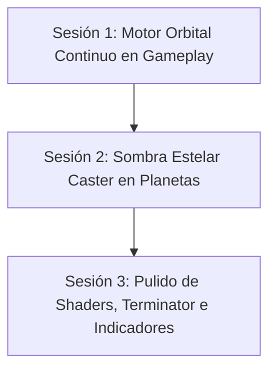

# Plan de Implementación: Órbitas Continuas y Sombras Celestes en Gameplay

Este documento define la hoja de ruta modular, dividida en **sesiones de trabajo atómicas** (respetando la regla de 1 Tarea = 1 Conversación y un consumo controlado de tokens), para lograr que los planetas destruibles y satélites orbiten de forma visible y continua, y que los planetas interactuables proyecten conos de sombra acordes a la estrella central de su sistema solar en Cosmos Engine.

---

## 🎯 Objetivos Principales
1. **Órbitas Continuas y Fluidas:** Lograr que satélites y planetas en gameplay mantengan traslación orbital visible alrededor de sus cuerpos centrales sin que el parallax o las congelaciones de interacción congelen la rotación Kepleriana.
2. **Proyección de Sombra Estelar:** Implementar un componente desacoplado (`GameplayPlanetShadowCaster2D`) que proyecte conos de sombra idénticos a los del sistema cósmico en los planetas de combate, con degradado penumbra y compatibilidad total con `VisibleOnScreenNotifier2D` e indicadores futuros.
3. **Preservación Radical de Contratos:** Zero-Allocation, sin romper colisiones de sectores (`PlanetSector`), disparadores [E], HUD ni `BulletServer`.

---

## 📅 Desglose por Sesiones Atómicas

---

### 🔹 Sesión 1: Motor Orbital Continuo en Gameplay (`OrbitalWorldFollower2D`)
**Objetivo:** Permitir que las entidades enlazadas a un `CosmosOrbitSlot` se trasladen de forma visible a lo largo de su trayectoria orbital en tiempo real.

- [x] **1.1 Desacoplamiento de Arrastre vs Tiempo Kepler:**
  - Archivo: `scenes/combat/environment/cosmos/core/orbital_world_follower_2d.gd`
  - Separar el tiempo orbital (`orbit_time`) del arrastre de parallax de la cámara (`parallax_anchor`).
  - Cuando un satélite está en rango de interacción del jugador (`freeze_parallax_drag = true`), congelar el offset de parallax respecto a la cámara para evitar que la estación se aleje del jugador abruptamente mientras interactúa, pero permitir una traslación suave o una rotación coherente si está fuera de interacción.
- [x] **1.2 Calibración de Velocidad Angular y Escala de Tiempo:**
  - Archivo: `scenes/combat/environment/cosmos/core/cosmos_orbital_slot_tracker.gd`
  - Asegurar que `angular_velocity` en `create_star_orbit_slot()` y `create_planet_orbit_slots()` produzca una velocidad de desplazamiento perceptible en combate (sin llegar a marear o romper el targeting de la nave).
- [x] **1.3 Sincronización de Físicas y Colisiones:**
  - Verificar que el desplazamiento continuo de `Planet.gd` y sus hijos `PlanetSector` no produzca desfasajes en `_physics_process` ni afecte el nido de drones defensores.
- [x] **1.4 Test Aislado:**
  - Ejecutar runner: `powershell -ExecutionPolicy Bypass -File tools/run_tests.ps1 -Test "tests/unit/test_gameplay_orbital_binding.tscn"`.

---

### 🔹 Sesión 2: Proyección de Sombra Estelar (`GameplayPlanetShadowCaster2D`)
**Objetivo:** Proyectar el cono de sombra umbra/penumbra detrás del planeta interactuable respecto a la estrella central del sistema.

- [x] **2.1 Creación del Componente Modular `GameplayPlanetShadowCaster2D`:**
  - Archivo nuevo: `scenes/combat/environment/gameplay_planet_shadow_caster_2d.gd`
  - Extiende de `Node2D` con tipado estricto.
  - Recibe la referencia al `CosmosOrbitSlot` (o la posición proyectada de la estrella central).
  - Instancia un `Sprite2D` con el shader existente `planetary_shadow_cone.gdshader` y textura `ImageTexture` de 2x2 px.
  - Se ubica con `z_index = -1` dentro del árbol del planeta o en el contenedor de entorno para proyectarse inmediatamente detrás de la corteza y manto.
- [x] **2.2 Integración en `PlanetSpawner.gd` y `Planet.gd`:**
  - En `PlanetSpawner._apply_star_orbit_binding()`, vincular el shadow caster al instanciar el planeta con un slot estelar.
  - Asegurar que al destruirse el planeta (`Planet.disintegrate()`), el cono de sombra haga fade out suave o se libere en paralelo sin dejar artefactos visuales.
- [x] **2.3 Test Específico:**
  - Crear/extender test unitario de verificación de sombras y slots estelares.

---

### 🔹 Sesión 3: Sombreado Terminator (Día/Noche) y Preparación para HUD
**Objetivo:** Iluminación visual sobre la corteza del planeta (lado claro vs lado oscuro) y preparación de sockets para futuros indicadores en pantalla.

- [ ] **3.1 Parámetro `light_direction` en la Corteza:**
  - Archivo: `core/shaders/planet_crust_destruction.gdshader` (o extensión de material).
  - Pasar el vector direccional estelar `light_direction` a la corteza y manto para que el lado opuesto a la estrella reciba un tinte de sombra natural similar a los planetas de fondo de Cosmos.
- [ ] **3.2 Preparación de Socket de HUD / Indicadores de Pantalla:**
  - Archivo: `scenes/combat/environment/planet.gd`
  - Añadir nodo `VisibleOnScreenNotifier2D` (con rect delimitador de 650x650 px).
  - Dejar expuestas señales `screen_entered` y `screen_exited` para que el sistema de HUD / Edge Trackers pueda montar marcadores o iconos sin tocar la lógica de sombra u órbita.
- [ ] **3.3 Verificación Integral:**
  - Ejecutar verificación final rápida con `test_space_environment_integration.tscn`.
