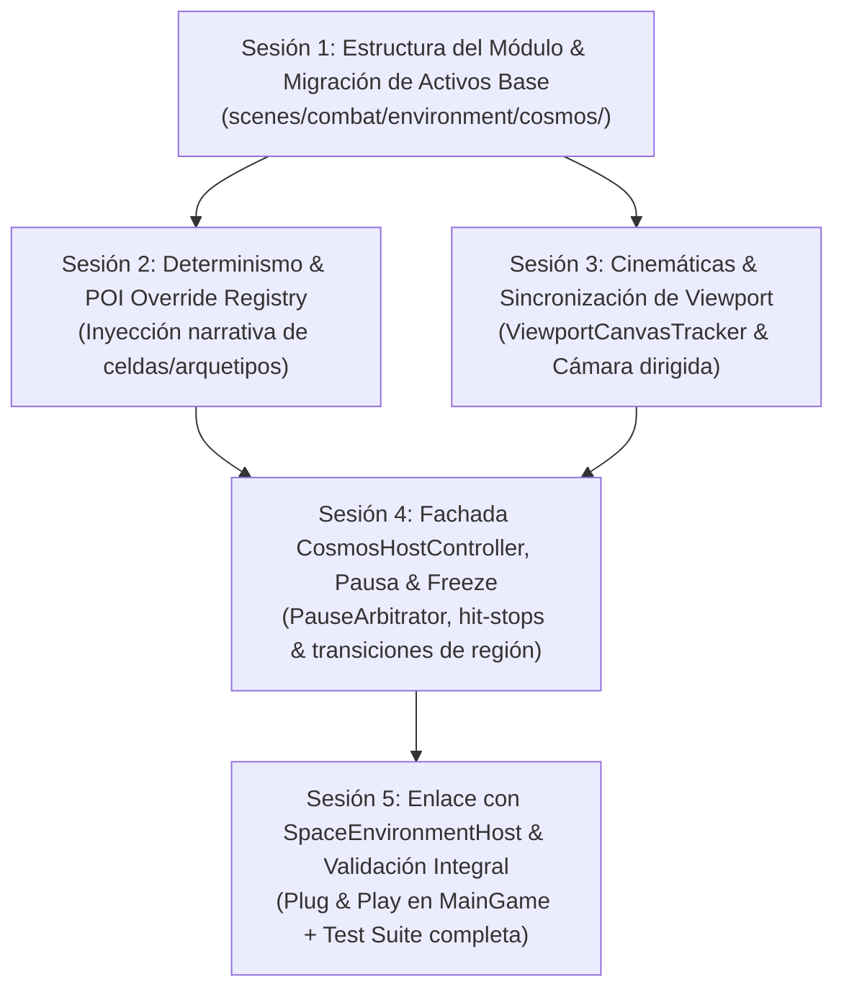

# Plan de Empaquetado y Promoción de Cosmos Engine — Sesiones Atómicas

> **Ubicación:** `docs/roadmap/PLAN_EMPAQUETADO_COSMOS_ENGINE.md`  
> **Objetivo:** Promover y empaquetar de forma modular el motor astronómico procedural desde `sandbox/` a producción (`scenes/combat/environment/cosmos/`), dotándolo de inyección determinista de celdas (POIs narrativos), seguimiento transparente de cinemáticas de cámara y compatibilidad total con `PauseArbitrator` y freezes de combate.  
> **Directriz de Ejecución:** Cumplir la regla de higiene de sesiones (1 Sesión / Tarea Atómica = 1 Conversación, máx. 12-15 turnos por sesión, pruebas aisladas con `tools/run_tests.ps1`).

---

## 🗺️ Mapa de Dependencias de las Sesiones



---

## 📦 Sesión 1: Estructura del Paquete en Producción & Copia Segura de Componentes
* **Objetivo:** Crear el árbol de producción bajo `scenes/combat/environment/cosmos/` y promover los scripts, shaders y recursos validados sin alterar `sandbox/` (manteniéndolo como playground/testbed).
* **Alcance Técnico:**
  1. Crear estructura de carpetas:
     - `scenes/combat/environment/cosmos/core/` (math, streamers, grid, hashing)
     - `scenes/combat/environment/cosmos/shaders/` (nebulosas, starfield, sombras, estrellas)
     - `scenes/combat/environment/cosmos/resources/` (perfiles de bioma, arquetipos de estrellas)
     - `scenes/combat/environment/cosmos/scenes/` (`cosmos_root.tscn`)
  2. Ajustar rutas de `preload` y dependencias cruzadas en los scripts promovidos para que apunten a la nueva ruta en producción.
  3. Garantizar tipado estricto en el 100% de los archivos movidos.
* **Criterio de Verificación:**
  - Test runner específico de integridad:
    ```powershell
    powershell -ExecutionPolicy Bypass -File tools/run_tests.ps1 -Test "tests/unit/test_cosmos_packaging_smoke.tscn"
    ```
* **Entregable:** Subescena base `cosmos_root.tscn` instanciable limpiamente bajo `scenes/combat/environment/cosmos/`.

---

## 📦 Sesión 2: Motor Determinista & `CosmicPoiRegistry` (Inyección Narrativa)
* **Objetivo:** Permitir que `MainGame` o los directores de eventos inyecten configuraciones específicas de soles/planetas/galaxias en coordenadas virtuales o relativas al jugador.
* **Alcance Técnico:**
  1. Diseñar el recurso de datos `CosmicPoiConfig.tres` (`archetype`, `planet_count`, `custom_label`, `hazard_level`).
  2. Implementar `CosmicPoiRegistry.gd`:
     - Almacenamiento $O(1)$ de overrides por coordenada de celda `Vector2i(gx, gy)`.
     - Métodos: `register_poi(coord: Vector2i, config: CosmicPoiConfig)`, `register_relative_poi(offset: Vector2i, config: CosmicPoiConfig, current_origin: Vector2i)`, `clear_overrides()`.
  3. Modificar `SolarSystemStreamer` y `GalaxyStreamer2D`:
     - Al recorrer las celdas en el frustum visible, verificar primero si `CosmicPoiRegistry.has_poi(cell)` está activo.
     - Si existe override, instanciar la entidad directamente con los parámetros del `CosmicPoiConfig` omitiendo el hash pseudoaleatorio.
* **Criterio de Verificación:**
  - Test runner aislado:
    ```powershell
    powershell -ExecutionPolicy Bypass -File tools/run_tests.ps1 -Test "tests/unit/test_cosmic_poi_registry.tscn"
    ```
* **Entregable:** Generación procedural sobreescribible en caliente sin fugas de memoria.

---

## 📦 Sesión 3: Compatibilidad con Cinemáticas & `ViewportCanvasTracker`
* **Objetivo:** Desacoplar el seguimiento de la cámara del nodo específico del jugador, sincronizando las capas de paralaje de forma continua y transparente con cualquier cámara activa o cinemática.
* **Alcance Técnico:**
  1. Implementar `ViewportCanvasTracker.gd`:
     - Extraer posición analítica efectiva, rotación y escala/zoom de la cámara activa mediante `get_viewport().get_canvas_transform()`.
     - Soporte para transiciones de cámara suaves (cinemáticas con `AnimationPlayer`, encuadres de boss o cinemáticas de victoria/game over).
  2. Adaptar `CosmosRoot` para alimentar a los streamers con las coordenadas visuales del `ViewportCanvasTracker`.
  3. Prevenir micro-saltos en `FloatingOriginTracker` durante movimientos rápidos de cinemática (clamp / interpolación de origen).
* **Criterio de Verificación:**
  - Test runner de cinemáticas y transform del viewport:
    ```powershell
    powershell -ExecutionPolicy Bypass -File tools/run_tests.ps1 -Test "tests/unit/test_cosmos_viewport_tracker.tscn"
    ```
* **Entregable:** Fondo cósmico reactivo tanto a juego libre como a cámaras dirigidas por cinemáticas sin necesidad de enlazar nodos manualmente.

---

## 📦 Sesión 4: Fachada `CosmosHostController`, Transiciones de Región & Freeze/Pausa
* **Objetivo:** Construir la API pública unificada del entorno cósmico que consumirá `MainGame`, integrando control de regiones, congelamiento por hit-stop y pausa de árbol.
* **Alcance Técnico:**
  1. Implementar `CosmosHostController.gd`:
     - API pública:
       - `change_region(region_id: StringName, blend_duration: float)`
       - `inject_poi_relative_to_player(...)` / `inject_poi_at_virtual_coords(...)`
       - `set_frozen(is_frozen: bool)`
     - Conexión a `PauseArbitrator.pause_state_changed`:
       - Al pausarse el juego, suspende el incremento de `_global_time` y congela los tweens de nebulosa activos.
     - Manejo de `set_frozen(true)` para congelar el tiempo cósmico durante micro-hit-stops de combate (sin requerir pausa del árbol completo).
  2. Implementar `CosmicBiomeBlender.gd` para interpolar suavemente los uniforms de color y turbulencia de los shaders de nebulosa y starfield durante cambios de región.
* **Criterio de Verificación:**
  - Test runner de fachada, pausa y hit-stop:
    ```powershell
    powershell -ExecutionPolicy Bypass -File tools/run_tests.ps1 -Test "tests/unit/test_cosmos_host_controller.tscn"
    ```
* **Entregable:** Fachada de alto nivel desacoplada y lista para conectarse al juego.

---

## 📦 Sesión 5: Integración Plug & Play en `SpaceEnvironmentHost` & Validación Integral
* **Objetivo:** Conectar el empaquetado final a `SpaceEnvironmentHost` en `scenes/combat/environment/` y validar en combate real a 60 FPS sin regresiones.
* **Alcance Técnico:**
  1. Asignar la subescena empaquetada como opción en `SpaceEnvironmentHost.gd`:
     - Configurar `custom_environment_scene` o default con `CosmosCombatEnvironment`.
  2. Enlazar eventos de inicio de oleada (`on_wave_started`) y narrativa de combate con `CosmosHostController`.
  3. Ejecutar suite completa de tests de combate y core:
     ```powershell
     powershell -ExecutionPolicy Bypass -File tools/run_tests.ps1 -Test "tests/unit/test_space_environment.tscn"
     powershell -ExecutionPolicy Bypass -File tools/run_tests.ps1 -CoreOnly
     ```
  4. Actualizar [`AGENT_CONTEXT.md`](AGENT_CONTEXT.md) reflejando la promoción oficial de Cosmos Engine al árbol de producción.
* **Criterio de Verificación:**
  - Main Game corriendo a 60 FPS estables con Cosmos Engine de fondo en combate.
  - Cero regresiones en danmaku (`BulletServer`), colisiones y HUD.
* **Entregable:** Cosmos Engine 100% operativo en producción.
