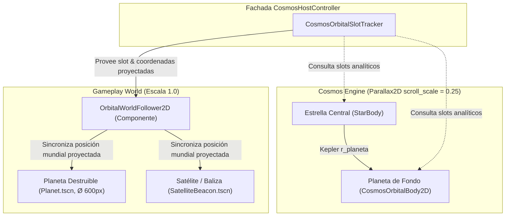

# Plan de Implementación: Órbitas de Gameplay en Sistemas Solares Cósmicos

> **Ubicación:** `docs/roadmap/PLAN_ORBITAS_GAMEPLAY_SISTEMAS_SOLARES.md`  
> **Objetivo:** Permitir que los planetas destruibles del gameplay orbiten estrellas de fondo y que los satélites (tiendas/balizas) orbiten planetas de fondo, conservando tamaños reales, físicas de colisión y sincronía matemática de paralaje sin alterar `BulletServer`.  
> **Regla de Desarrollo:** Modularidad estricta, arquitectura data-driven, componentes desacoplados y arnés de pruebas automatizado (1 Tarea = 1 Sesión).

---

## 🗺️ Arquitectura Técnica y Estrategia de Coordenadas

---

## 📋 Desglose de Entregables para la Nueva Sesión

### 1. `CosmosOrbitalSlotTracker` / API en `CosmosHostController`
* Estructura de datos tipada `CosmosOrbitSlot`:
  - `center_type`: `STAR` o `PLANET`.
  - `orbit_center_cell`: `Vector2i` del sistema solar en el macro-grid.
  - `orbit_radius`: `float` en espacio de capa.
  - `angular_velocity`: `float` ($\omega$).
  - `initial_phase`: `float` ($\theta_0$).
  - `body_reference`: Referencia al nodo cósmico si está activo en el frustum.
* Métodos en `CosmosHostController`:
  - `get_star_orbit_slots(world_position: Vector2, search_radius: float) -> Array[CosmosOrbitSlot]`
  - `get_planet_orbit_slots(world_position: Vector2, search_radius: float) -> Array[CosmosOrbitSlot]`
  - `project_slot_to_world(slot: CosmosOrbitSlot, global_time: float, camera: Camera2D) -> Vector2`

### 2. Componente Modular: `OrbitalWorldFollower2D`
* Nodo de responsabilidad única que se añade a cualquier entidad de combate:
  - Expone `slot: CosmosOrbitSlot`.
  - En `_process(delta)` o evaluación de evento, proyecta la posición analítica exacta combinando el desplazamiento de la cámara, el paralaje ($0.25$) y la órbita kepleriana.
  - Garantiza que la nave del jugador colisione normalmente y el HUD/radar mantenga el tracking sin jitter.

### 3. Integración con `CombatSatelliteCoordinator` & `CombatSpaceDebrisManager`
* `CombatSatelliteCoordinator`:
  - Al spawnear `SatelliteBeacon`, consulta `get_planet_orbit_slots()` más cercano al jugador. Si existe uno disponible, el satélite se acopla a la órbita de ese planeta de fondo.
* `CombatSpaceDebrisManager` / `PlanetSpawner`:
  - Al spawnear `Planet.tscn`, consulta `get_star_orbit_slots()`. El planeta destruible toma una órbita kepleriana exterior alrededor del sol de fondo.

### 4. Arnés de Pruebas Automatizadas
* Test suite: `tests/unit/test_gameplay_orbital_binding.tscn`:
  - Verifica que las posiciones proyectadas coincidan con el frustum de la cámara.
  - Comprueba que la órbita no presente deriva numérica tras miles de frames.
  - Valida la coexistencia limpia con `BulletServer` y áreas de colisión.

---

## 🎯 Criterio de Aceptación
1. Satélites orbitando de forma continua y suave planetas de fondo sin salir despedidos ni desfasar la cámara.
2. Planetas destruibles orbitando soles a distancia segura, manteniendo sus 600 px y destrucciones de sectores intactas.
3. 100% de tests unitarios e integración en verde.
